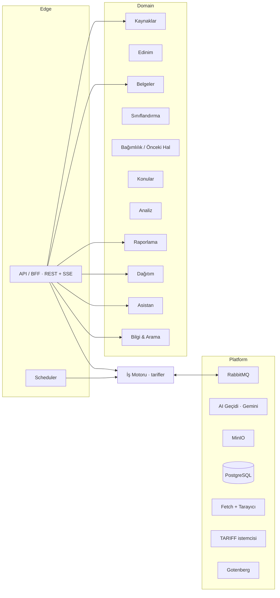
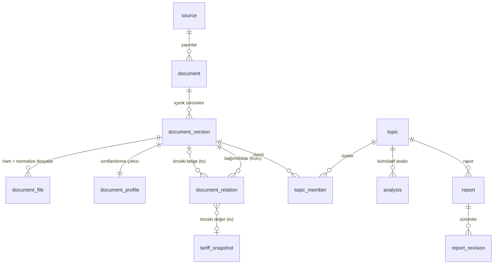
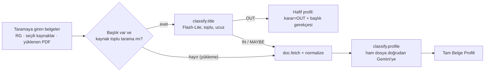
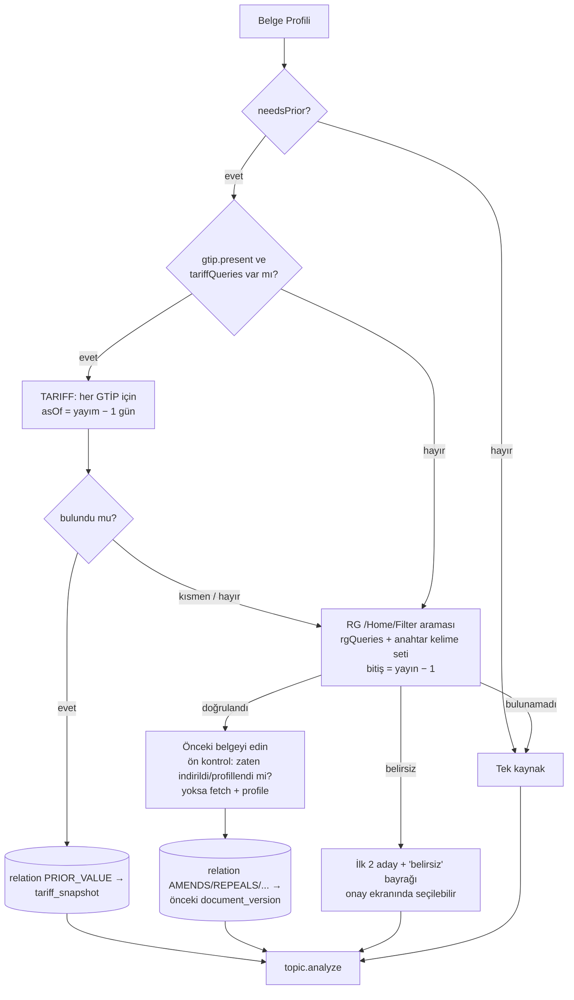

# ATEZ Mevzuat Radarı — Sıfırdan Hedef Mimari (v4)

Tarih: 2026-10-16 · Durum: Taslak v4 — `codex/source-engine-redesign` dalıyla (`97d5c1c`) hizalandı. Dalın planları ve kodu, yeni repo için bu belgenin girdisidir. Hangi parçaların alındığı, hangilerinin değiştiği ve hangi çelişkilerin karar beklediği **Ek B**'dedir.

Bu proje şirketin GitHub'ına **yeni bir repo** olarak taşınacak. Belge bu yüzden mevcut koda bağlı kalmadan, sıfırdan (greenfield) bir tasarım olarak yazıldı. Mevcut sistemden yalnızca ürün ihtiyaçları ve öğrenilen dersler alındı (Ek A).

---

## 0. Kararlar

| # | Karar |
|---|---|
| K1 | **Onay adımı yok (2026-10-16 güncellemesi).** Üretilen bütün raporlar doğrudan **"Gönderime hazır" (`READY`)** olarak listelenir. Sistem şimdilik **otomatik e-posta göndermez**; gönderim, kullanıcının bir rapor için "Gönder" demesiyle yapılır. Onay kuyruğu, ileride gerekirse aynı durum makinesine eklenebilecek bir adım olarak tasarımda bekler. |
| K2 | Destekleyici kaynaklar rapora katkı verir: ya bir rapora kanıt olur ya da kendi raporunu açar. |
| K3 | Resmî Gazete en kritik kaynaktır. Diğer kaynaklar seyrek değişir; değişiklik geldiğinde tarih aralığındaki bütün duyurular ve ekleri taranır. Belgeler çok büyük olabilir. |
| K4 | **TARIFF, önceki değerleri bulmak için kullanılan bir araçtır.** Haber akışı da ayrı bir kaynak olarak okunabilir. GTİP ile ilgili değişikliklerde önceki değer **yayım tarihi − 1 gün** için sorgulanır (`PUBLICATION_PREVIOUS_DAY`, 2026-10-16 kararı). Yürürlük − 1 kuralı kullanılmaz: yürürlük tarihi gelecekteyse o tarih için sorgu yapılamaz (§7.1). |
| K5 | TARIFF'te bulunamayan ya da GTİP dışı değişikliklerde önceki kaynak, **Resmî Gazete filtre aramasıyla** ve anahtar kelimelerle aranır. Bulunamazsa süreç **tek kaynakla** devam eder. |
| K6 | Kullanıcı chat'ten **kendi yüklediği belge** için istediği adımları çalıştırabilir: yalnızca filtre, yalnızca analiz, şablonlu rapor ya da seçili adımlar. |
| K7 | Hiçbir süreç kendine özel bileşen veya worker kullanmaz. Rapor üretimi dahil her şey aynı adımlarla yapılır. |
| K8 | Kaynaklar **kod değiştirmeden config ile** tanımlanır. Yeni kaynak, scraper ve gerektiğinde browser agent ile test edilerek bağlanır. |
| K9 | Altyapı: şirketin **RabbitMQ**'su, **MinIO**, **PostgreSQL**. Kimlik doğrulama daha sonra şirketin **Keycloak**'u ile yapılacak. |
| K10 | Chat'te zengin fonksiyonellik olacak. Ancak yanlış fonksiyon çağrısına karşı kontrollü ve token açısından optimum çalışmalı. |
| **K11** | **Ayrı bir OCR veya metin çıkarma hattı kurulmaz** (dalın OCR planından farkı için bkz. Ek B-Ç2). Ham belge (PDF, HTML, görsel) doğrudan Gemini'ye verilir; Gemini bunları yerel olarak okur. Saklanan şeyler: ham belge, kısa metadata, AI çıktıları (profil, analiz). |
| **K12** | **İlk AI adımı olan sınıflandırma (filtre), metadata üreticisidir.** Taramaya giren her belge (RG, seçili kaynaklar veya yüklenen PDF) sınıflandırılır ve bir **Belge Profili** üretilir. Profil şunları içerir: karar ve gerekçe, içerik bilgileri, GTİP'ler, önceki kaynak gerekip gerekmediği ve arama ipuçları. |
| **K13** | Önceki kaynak veya önceki değer bulunduğunda belge buna **bağımlılık bağlantısıyla** bağlanır. Bu bağlantı ya önceki belgeye ya da TARIFF anlık görüntüsüne verilir. |
| **K14** | Analiz **kümülatif** yapılır. Her mevzuat değişikliği, bulunan önceki hal ile birlikte analiz edilir; karşılaştırma tabloları bu sayede çıkarılabilir. |
| **K15** | Backend tasarımı mevcut yapıdan bağımsız, temiz bir yapıdır. Mevcut UI ihtiyaçları ürün kapsamına girdi olarak alındı. |

---


### 0.1 Karar güncellemeleri (2026-10-16, son)

| Konu | Karar |
|---|---|
| AI sağlayıcı ve model | **Vertex AI, `global` uç noktası (2026-10-17 kararı).** Not: `global` uç noktası işlemenin AB içinde kalacağını garanti etmez. Veri yerleşimi gerekirse `VERTEX_LOCATION` bir AB bölgesine çevrilir (2026-10-17 yoklamasında bu modeller yalnızca `eu` çok-bölgeli uç noktasında vardı; `europe-west4` gibi tek AB bölgeleri 404 döndü). Ana model `gemini-3.8-flash` (sürüm sabitlenir). Hafif işler `gemini-3.5-flash-lite` ile yapılır: başlık elemesi, yönlendirme, başlık üretimi, özet, küçük düzeltmeler, belirsiz eşleştirme. |
| Onay ve gönderim | Onay adımı yok. Bütün raporlar `READY` ("Gönderime hazır") olur. Otomatik e-posta gönderilmez. |
| Altyapı | Şirketin mevcut **RabbitMQ**, **PostgreSQL** ve **MinIO** kurulumları kullanılır, yeni kurulum yapılmaz. Altyapı ekibinden gereken tek şey bu uygulamaya ait bir RabbitMQ vhost'u ve kullanıcısı, bir Postgres veritabanı ve kullanıcısı, bir MinIO bucket'ı ve erişim anahtarı. `pgvector` yalnızca anlamsal arama faz 6'ya gelince gerekir. |
| Konu eşleştirme | Kesin eşleşme (RG bağlantısı veya resmî numara) ya da AI ile "aynı olay" tespiti yapılamazsa belge **ayrı konu** olarak kalır. |
| Mevzuat.Net | Günlük işlemde anasayfadaki **Son Dakika haberleri** ve haberlerin içinde ek bağlantısı varsa o ekler okunur (ekler resmî veya herkese açık bir hedefe gidiyorsa). Chat'ten geçmişe dönük bir tarih sorulduğunda kayıt son ~20 haber içinde yoksa şu mesaj verilir: *"Bu tarihe ait kayıt bulunamadı. Geçmiş kayıtlara erişmek için lütfen Kaynaklar ekranından Mevzuat.Net aboneliğinizi aktifleştirin."* Güncellik listesi kapsam kontrolü olarak kalır. |
| mevzuat.gov.tr | Sonraya bırakıldı. |
| Ek dosyası alan adları (2026-10-17) | Belgelerin ek dosyalarının bulunduğu alan adları (ör. `files.igmd.org.tr`) **kaynak değildir**. Eski uygulamadaki gibi belge URL'lerinden otomatik "kaynak" eklenmez (`ensureWorkspaceCatalog` REFERENCE kaynakları v2'ye taşınmaz). Bu alan adları ilgili kaynak tanımının `attachments.allowHosts` listesinde durur ve kaynak listesinde görünmez (§9.3). |
| Mevzuat.Net kapsamı (2026-10-17) | Kullanıcı adı ve şifre verilene kadar yalnızca anasayfadaki **Son Dakika** listesinin son ~20 kaydıyla çalışılır. `Guncellik.aspx` ve `rgicerik` kapsam kontrolü olarak kalır. Kimlik bilgisi sonradan girilirse abonelikli erişim ayrı bir kararla açılır; o zamana kadar kapalıdır. |
| Kaynak kimlik bilgileri (2026-10-17) | Kaynaklar ekranında yönetilir (§9.3): "Kaynak ekle", satır bazında "Düzenle", sunucuda AES-256-GCM ile şifreli saklama, şifrenin arayüze asla geri dönmemesi, "Test et". TARIFF bilgileri de bu ekrandan girilir; `.env` yalnızca yerel geliştirmede yedek kaynaktır. |
| TARIFF silinmiş kayıt (2026-10-17 kararı) | Bir TARIFF kaydı yalnızca `was_deleted = true` ise ya da `deleted_at` dolu olup kayıt o tarihten sonra güncellenmemişse silinmiş sayılır. Gerekçe: 31.12.2025 gözetim örneğinde (2018/1 değişikliği, 8714.91.10.00.11/.19) yürürlükteki kayıt `deleted_at: 2020-10-23` ama `updated_at: 2026-01-03` taşıyordu, 29.01.2026'ya kadar geçerliydi ve değeri RG'deki 2018/1 tebliğiyle örtüşüyordu. Böyle bir kayıttan alınan değer raporda satır notuyla gösterilir (§7). Kabul edilen risk: gerçekten silinmiş ama sonradan güncellenmiş bir kayıt yanlışlıkla kullanılabilir. |

## 1. Ürün kapsamı ve ekranlar

Mevcut UI'dan çıkarılan ihtiyaçlar şunlar:

| Ekran | Amaç | Temel aksiyonlar |
|---|---|---|
| **Gösterge paneli** | Günün durumu | Günlük slot zaman çizelgesi (05/10/15/23), çalışan işler, **onay bekleyenler**, son gönderimler, gerçek KPI'lar |
| **Onay kuyruğu** | Ana iş listesi (K1) | Raporu önizle, düzenle, onayla, reddet, toplu onayla, gönder |
| **İş (Run) detayı** | Bir tarama veya tarifin ilerlemesi | Canlı adım ilerlemesi, belge listesi (karar + gerekçe + profil), hatalı öğeleri yeniden dene |
| **Belge detayı** | Bir belgenin bütün izi | Ham belge görüntüleyici, profil, bağımlılıklar (önceki kaynak, TARIFF), konu, analiz, raporlar |
| **Rapor** | Rapor ve revizyon | Önizleme, satır içi düzenleme, öneri kartları (kabul/ret), sürüm karşılaştırma, PDF, gönderim |
| **Asistan** | Tek sohbet | Soru-cevap, belge yükle ve adım seç, iş başlat, revize et, onayla, gönder (onay kartlarıyla) |
| **Kaynaklar** | Kaynak kataloğu | Kaynak listesi ve sağlık durumu, yeni kaynak ekleme (onboarding), tanım sürümleri, tarih aralığı taraması |
| **Şablonlar** | Rapor şablonları ve kart bileşenleri | Düzenle, önizle, sürümle |
| **Alıcı grupları** | Dağıtım | Grup ve sektör etiketleri, adresler |
| **Ayarlar** | Politika ve config | Anahtar kelime setleri, kaynak politikaları, tarifler, model ve bütçe ayarları |

---

## 2. Tasarım ilkeleri

1. **Modüler monolit ve uzmanlaşmış worker havuzları.** Tek repo, tek imaj, katı modül sınırları.
2. **Adım kataloğu ve tarifler.** Her iş, sözleşmeli genel bir adımdır. Her süreç, bu adımların JSON ile tanımlanmış bir dizilimidir; buna **tarif** diyoruz (K6, K7).
3. **Belge merkezli artefaktlar.** Her belge sürümünün etrafında değişmez artefaktlar birikir: ham dosya, profil, ilişkiler, analiz, rapor. Ara metin kopyası tutulmaz (K11).
4. **Profil bir kez üretilir, her yerde kullanılır.** Önceki hal, konu eşleştirme, analiz, rapor kartı seçimi ve chat araması aynı profilden beslenir (K12).
5. **İçerik kimliğiyle delta ve önbellek.** Önbellek anahtarı `contentHash + adım + config sürümü`'dür. Değişmeyen belgeye ikinci kez AI çağrısı yapılmaz.
6. **Config, kod değildir.** Kaynak tanımları, politikalar, tarifler, anahtar kelime setleri, şablonlar ve prompt sürümleri sürümlü veri olarak tutulur.
7. **Komut ve olay ayrımı, outbox, idempotent tüketici.**
8. **AI ve ajanlar yalnızca gerektiği yerde.** Rutin tarama deterministik çalışır; ajanlar onboarding, onarım ve araştırma içindir.
9. **Tek AI geçidi.** Model seçimi, önbellek, retry, kota, denetim ve maliyet tek noktadan yönetilir.
10. **İnsan onayı birinci sınıf adımdır.**

---

## 3. Modüller



| Modül | Sorumluluk | Sahip olduğu veri |
|---|---|---|
| **Kaynaklar** | Kaynak tanımları (sürümlü config), politikalar, sağlık durumu, onboarding | `source`, `source_definition`, `source_health` |
| **Edinim** | Genel kaynak çalıştırıcı. Listeyi gezer, detaya iner, ekleri indirir, delta tespit eder. Kullanıcı yüklemelerini de alır. | `document`, `document_version`, `attachment` |
| **Belgeler** | Ham dosya deposu, biçim normalizasyonu (DOCX/XLSX → PDF, büyük PDF bölme), belge görüntüleme | `document_file` |
| **Sınıflandırma** | Başlık ön elemesi ve **Belge Profili** (karar, gerekçe, metadata) | `document_profile` |
| **Bağımlılık / Önceki Hal** | Profil ipuçlarıyla önceki hali bulur: TARIFF, RG araması. Bağımlılık bağlantıları kurar. | `document_relation`, `tariff_snapshot`, `resolution_attempt` |
| **Konular** | Kaynaklar arası "aynı mevzuat olayı" kümelemesi | `topic`, `topic_member` |
| **Analiz** | Kümülatif analiz ve karşılaştırma tabloları | `analysis` |
| **Raporlama** | Şablon ve kartlar, spec, render, doğrulama, taslak, revizyon, onay | `report`, `report_revision`, `report_draft`, `report_edit`, `template` |
| **Dağıtım** | PDF, e-posta, alıcı grupları | `recipient_group`, `dispatch` |
| **Asistan** | Konuşmalar, yönlendirme, araç paketleri, aksiyon önerileri, kişiselleştirme | `conversation`, `message`, `message_action`, `user_preference` |
| **Bilgi & Arama** | Profil ve analizler üzerinde hibrit arama, mevzuat soy ağacı, GTİP değer geçmişi | `search_index`, `gtip_value` |
| **İş Motoru** | Tarif tanımları, `run` / `run_step` / `work_item`, fan-out/fan-in, kurtarma, takvim | `recipe`, `run`, `run_step`, `work_item`, `step_result`, `schedule` |

**Kural:** Modüller birbirinin altyapı katmanını import etmez. Senkron ihtiyaçlar karşı modülün public facade'ı üzerinden, asenkron ihtiyaçlar mesajla karşılanır.

---

## 4. Belge ve artefakt modeli

### 4.1 Kavramlar



- **`document`**: bir kaynaktaki tek yayın.
  - Kimliği `(sourceId, canonicalKey)`. `canonicalKey`, varsa resmî referans no, yoksa normalize URL'dir.
  - Kullanıcı yüklemeleri `source = USER_UPLOAD` olur.
- **`document_version`**: belgenin belirli bir içeriği (`contentHash`). Aynı hash ikinci kez gelirse yeni sürüm açılmaz.
- **`document_file`**: dosyalar ve rolleri:
  - `ORIGINAL`: indirilen ham dosya; HTML, PDF, DOCX, XLSX, görsel olabilir.
  - `MODEL_INPUT`: Gemini'ye verilecek biçim. PDF/HTML/görsel için ORIGINAL'in kendisidir; DOCX/XLSX için Gotenberg ile üretilmiş PDF'tir.
  - `PART`: 1.000 sayfa / 50 MB sınırını aşan PDF'lerin sayfa aralığı parçaları (`pdf-lib` ile bölünür, metin çıkarılmaz).
  - `ATTACHMENT`: belgenin ekleri. Her ek ayrı bir `document_version` olarak da işlenebilir ve `ATTACHMENT_OF` ilişkisiyle bağlanır.
- **`document_profile`**: sınıflandırma çıktısı; §6'da ayrıntılı.
- **`document_relation`**: bağımlılık bağlantısı (§7).
  - `from` her zaman mevcut belgedir.
  - `to` ya önceki bir `document_version` ya da bir `tariff_snapshot` olur.
  - Tipler: `AMENDS`, `REPEALS`, `EXTENDS`, `IMPLEMENTS`, `REFERENCES`, `ATTACHMENT_OF`, `SAME_EVENT`.
- **`topic`**: bir mevzuat olayı. Rolü `PRIMARY` olan belge ile `SUPPORTING`/`SIGNAL` rolündeki belgeler aynı topic altında toplanır.

### 4.2 MinIO yerleşimi

Bütün anahtarlar tek bir `StorageKeys` modülünden üretilir.

```text
documents/{sha256[0:2]}/{sha256}.{ext}                       # ham ve normalize dosyalar (içerik adresli, tekil)
artifacts/documents/{documentVersionId}/profile.v{n}.json     # Belge Profili (+ ham AI yanıtı)
artifacts/tariff/{gtip}/{date}.json                           # TARIFF anlık görüntüsü
artifacts/topics/{topicId}/analysis/r{nn}.json                # kümülatif analiz
artifacts/reports/{reportId}/r{nn}/{spec.json, report.html, report.pdf}
uploads/{conversationId}/{uuid}.{ext}                         # chat yüklemeleri (işlenince documents/ altına taşınır)
fixtures/sources/{sourceId}/v{n}/...                          # kaynak tanımı altın testleri
```

Veritabanında yalnızca metadata, ilişkiler, profilin sorgulanabilir alanları ve durumlar tutulur. Büyük JSON'lar MinIO'da durur; DB'de ise özetleri ve indekslenmiş alanları yer alır.

---

## 5. Adım kataloğu ve tarifler

### 5.1 Adımlar

| Adım | Girdi → Çıktı | AI | Havuz |
|---|---|---|---|
| `source.discover` | kaynak tanımı + tarih/aralık → belge adayları (başlık, URL, tarih) | — | io |
| `doc.delta` | aday → yeni / değişti / aynı | — | io |
| `doc.fetch` | aday → `document_version` + ORIGINAL + ekler | — | io |
| `doc.normalize` | ORIGINAL → MODEL_INPUT (DOCX/XLSX→PDF), büyük PDF → PART'lar | — | doc |
| `classify.title` | başlık listesi → IN / OUT / MAYBE + kısa gerekçe (toplu) | lite | ai-lite |
| `classify.profile` | belge (yerel dosya) → **Belge Profili** | main | ai-main |
| `extract.table` | profilde işaretlenen tablo sayfaları → yapılandırılmış satırlar (GTİP vb.) | main | ai-main |
| `lineage.resolve` | profil ipuçları → önceki hal + `document_relation` | lite + araç | ai-lite / io |
| `topic.link` | profiller → topic kümeleri | lite (belirsizse) | ai-lite |
| `topic.analyze` | topic + bağımlılıklar → kümülatif analiz | main | ai-main |
| `report.compose` | analiz + şablon → spec | — | render |
| `report.render` | spec → HTML + doğrulama (+ PDF) | — | render |
| `report.patch` | taslak + istek → alan düzenleme önerileri | lite/main | ai-interactive |
| `gate.review` | rapor → onay bekler | — | insan |
| `report.publish` | onaylı taslak → revizyon | — | render |
| `delivery.send` | revizyon + alıcılar → e-posta | — | delivery |
| `summary.compose` | iş çıktıları → kısa özet (chat / UI) | lite | ai-lite |

### 5.2 Tarifler (aynı adımların farklı dizilimi)

| Tarif | Dizilim |
|---|---|
| `daily-scan` (RG + seçili kaynaklar) | discover → delta → classify.title → fetch (IN/MAYBE) → normalize → classify.profile → extract.table? → lineage.resolve → topic.link ‖ → topic.analyze → report.compose → report.render → gate.review |
| `source-range-scan` | `daily-scan` ile aynı, `discover` için tarih aralığı |
| `upload-classify` | normalize → classify.profile → summary |
| `upload-analyze` | normalize → classify.profile → lineage.resolve → topic.analyze → summary |
| `upload-report` | `upload-analyze` + report.compose(`templateId`) → report.render → gate.review |
| `custom` | kullanıcının seçtiği adımlar. Eksik bağımlılıklar otomatik eklenir; önceden üretilmiş `step_result` varsa yeniden kullanılır. |
| `report-revision` | report.patch → report.render → taslak (gerekirse topic.analyze'a yükselir) |
| `dispatch` | report.render(pdf) → delivery.send |
| `source-onboarding` | probe → propose → (agent) → validate → gate.review |

Tarifler JSON olarak tanımlanır. Koşullar CEL ile yazılır (`when: "profile.decision == 'IN'"`). Tarifler sürümlü tutulur ve kayıt sırasında doğrulanır.

**Planlayıcı ve tarif birlikte çalışır** (dalın `WorkflowRequest` modeli):

- İstek şu alanlarla gelir:
  - `intent`
  - `entry` (belge, kaynak veya rapor kimlikleri)
  - `target` (`REPORT_DRAFT | EXPORT | SEND`)
  - `policies`:
    - `filter`: `RUN | SKIP_USER_SELECTED`
    - `research`: `AUTO_IF_NEEDED | SKIP`
    - `comparison`: `PUBLICATION_PREVIOUS_DAY` (tek geçerli değer; alan, ileride yeni bir kural gerekirse diye sürümlü tutulur)
    - `reuse`
  - `templateRevisionId`
  - `instruction`
- Planlayıcı adımları adım kataloğundaki bağımlılıklardan türetir. Tarifler, sık kullanılan istekler için **hazır, isimli politika setleridir**.
- Planlayıcı kullanıcının istemediği bir filtre veya araştırma adımı **eklemez**. Okuma gibi zorunlu önkoşulları ise her zaman ekler ve plan özetinde gösterir.
- **Çalışma modları:**

  | Mod | Davranış |
  |---|---|
  | `REUSE_ONLY` | Dış çağrı yapılmaz; yalnızca neyin eksik olduğu döner. |
  | `FILL_MISSING` | Varsayılan. Yalnızca eksik ya da geçersiz çıktılar üretilir. |
  | `FORCE` | Seçilen adımın yeni bir sürümü üretilir. |

- Yeniden kullanım anahtarı: `actorScope + adım + girdi hash'leri + politika/prompt/adapter/model sürümleri`.
- Yayım tarihi bilinmiyorsa iş `WAITING_INPUT` durumuna geçer; **bugünün tarihi varsayılmaz**.
- "Belge yüklemek analizi başlatmaz, analiz rapor yayımlamaz, yayım e-posta göndermez." Bu üç ilke dalda olduğu gibi korunur.

---

### 5.3 Ön kontrol: tekrar eden işi baştan elemek

Her tarama, işe başlamadan önce **önceki taramaların kayıtlarına bakar**. Kontroller ucuzdan pahalıya dört basamakta yapılır; her basamak bir sonrakine gidecek işi azaltır.

| Basamak | Soru | Nasıl | Maliyet |
|---|---|---|---|
| **0. Kaynak** | Bu kaynakta, bu tarih için son taramadan beri yeni bir şey var mı? | **RG:** günün fihrist sayfası ve **mükerrer butonu**. Yeni bir sayı (ana veya Mn) yoksa tarama burada biter. **Diğer kaynaklar:** liste sayfası okunur; `ETag`/`Last-Modified` veya liste hash'i aynıysa tarama biter. | 1 istek |
| **1. Öğe** | Bu duyuru veya belge daha önce görüldü mü? | Kimlik = `kaynak + canonicalKey` (resmî no / normalize URL) + yayım tarihi. Bilinmeyen kimlik → yeni. Bilinen kimlik → 2. basamak. | DB sorgusu |
| **2. İçerik** | Daha önce indirildiyse değişti mi? | Önce koşullu istek (`If-None-Match` / `If-Modified-Since` / `Content-Length`). Belirsizse indirilir ve `contentHash` karşılaştırılır. Aynı hash → yeni sürüm açılmaz. | HEAD veya tek GET |
| **3. Adım** | Bu içerik için bu adım daha önce yapıldı mı? | `step_result` anahtarı: `contentHash + adım + prompt/model/config sürümü`. Varsa sonuç yeniden kullanılır (profil, tablo, analiz). | DB sorgusu |

- **Sonuç türleri:** her öğe taramada `YENİ`, `DEĞİŞTİ`, `AYNI (atlandı)` veya `ÖNBELLEKTEN` olarak işaretlenir. İş ekranında bu sayılar gösterilir; örneğin "42 duyuru · 3 yeni · 1 değişti · 38 atlandı".
- **Günün 4 RG slotu:** 05:00 ana sayıyı işler. 10:00, 15:00 ve 23:00 yalnızca mükerrer butonuna bakar; yeni bir Mn sayısı yoksa hiçbir AI çağrısı yapılmaz.
- **Değişen belge** (2026-10-16 kararı): içerik hash'i değiştiyse bu **her zaman değişiklik sayılır**. Ayrıca "anlamlı mı?" diye bir AI elemesi yapılmaz.
  - Yeni `document_version` açılır ve değişen adımlar yeniden çalışır.
  - Bu belgeden yayımlanmış bir rapor varsa rapor kendiliğinden değişmez. Bir **revizyon taslağı** açılır ve onay kuyruğuna düşer.
  - Kullanıcıya kısa bir **değişiklik notu** gösterilir. Not şunları içerir:
    - "Kaynakta güncellendi" ifadesi,
    - eski ve yeni sürümün tarihleri,
    - kodla çıkarılmış metin farkının ilk birkaç satırı (değişen satırlar ve sayılar).

    Not taslakta ve onay kuyruğunda görünür.
- **Tarih aralığı taramaları da aynı kontrollerden geçer.** Örneğin İGMD'nin 1–15 Ekim aralığı yeniden istendiğinde yalnızca yeni veya değişmiş duyurular işlenir.
- **Önceki kaynak olarak bulunan belgeler de aynı ön kontrolden geçer.** Aynı tebliğ başka bir değişiklikte tekrar "önceki hal" olarak çıkarsa yeniden indirilmez ve profillenmez.

## 6. Sınıflandırma ve Belge Profili (K11, K12)

### 6.1 İki kademeli sınıflandırma



- **Başlık ön elemesi** yalnızca maliyet içindir. Resmî Gazete'de bir günde yüzlerce başlık olabilir, OUT çıkanlar hiç indirilmez. Bu belgelerin de karar ve gerekçe içeren hafif bir profili olur; böylece "neden elendi?" sorusu her zaman cevaplanabilir.
- **Profil adımı**, belgenin kendisini (PDF/HTML/görsel) **yerel olarak** Gemini'ye verir. OCR ve metin çıkarma yapılmaz.
  - Taranmış PDF'leri model görsel olarak okur.
  - HTML metin olarak verilir.
  - DOCX ve XLSX önce Gotenberg ile PDF'e çevrilir; bu biçim dönüşümüdür, metin çıkarma değildir.

### 6.2 Belge Profili şeması (özet)

```jsonc
{
  "schemaVersion": 1,
  "decision": "IN | OUT | REVIEW",        // gümrük/dış ticaret ilgisi; okunamayan/eksik veya belirsiz → REVIEW
  "coverage": {                           // dalın DocumentAssessment.coverage alanı
    "expected": { "files": 3, "pages": 42, "tables": 2 },
    "read":     { "files": 3, "pages": 42, "tables": 2 },
    "complete": true                      // false → decision en fazla REVIEW olabilir
  },
  "basisQuotes": [{ "quote": "…", "file": "f1", "page": 3 }],   // kod tarafından kaynakta birebir doğrulanır
  "relevance": { "score": 0-1, "categories": ["ithalat", "gozetim", "mense", "..."] },
  "rationale": "Kısa ama içeriğe dayalı gerekçe; hangi bölüm/madde nedeniyle ilgili",
  "identity": {
    "docType": "TEBLIG | KARAR | YONETMELIK | GENELGE | DUYURU | KANUN | ...",
    "title": "...", "institution": "...", "officialNumber": "2026/12",
    "publication": { "date": "2026-10-15", "rgIssue": "33xxx", "mukerrer": null }
  },
  "summary": "2–4 cümlelik içerik özeti",
  "change": {
    "kind": "NEW | AMENDMENT | REPEAL | EXTENSION | SUSPENSION | ANNOUNCEMENT | NONE",
    "effectiveRules": [                   // tarih modelden değil, koddan çözülür
      { "rule": "ON_PUBLICATION | EXPLICIT_DATE | DAYS_AFTER_PUBLICATION | UNRESOLVED",
        "explicitDate": "2026-11-01", "days": null, "scope": "Madde 2", "evidencePage": 3 }
    ]
  },
  "gtip": {
    "present": true,
    "codes": [{ "code": "8703.23", "level": "6", "context": "gözetim değeri", "page": 5 }],
    "tables": [{ "title": "EK-1", "pages": [5, 6, 7], "approxRows": 420, "columns": ["GTİP", "Eşya", "Gözetim değeri"] }]
  },
  "references": [
    { "relation": "AMENDS", "targetTitle": "İthalatta Gözetim Uygulamasına İlişkin Tebliğ",
      "targetNumber": "2015/5", "targetType": "TEBLIG", "articles": ["Madde 4"] }
  ],
  "lineage": {
    "needsPrior": true,
    "strategyHint": "TARIFF | RG_SEARCH | NONE",
    "rgQueries": ["2015/5 gözetim tebliği", "İthalatta Gözetim Uygulamasına İlişkin Tebliğ"],
    "tariffQueries": [{ "code": "8703.23", "field": "GOZETIM_DEGERI", "asOf": "2026-10-31" }]
  },
  "affected": { "parties": ["ithalatçılar"], "sectors": ["otomotiv"] },
  "keyPages": [1, 2, 5],                  // analizde öncelikli sayfalar
  "keywords": ["gözetim", "kıymet", "..."],
  "confidence": 0-1
}
```

**Kurallar**

- `rationale` belge içeriğine **dayanmak zorundadır** ve sayfa veya madde referansı içerir.
- `tariffQueries[].asOf` alanını model hesaplamaz. Kod deterministik olarak `yayım tarihi − 1 gün` yazar (§7.1). Model yalnızca GTİP'i ve alanı işaretler.
- `basisQuotes` ve analizdeki her alıntı, kaynak metinde **birebir** aranır. Bulunamayan alıntı için tek bir onarım turu yapılır; yine bulunamazsa karar REVIEW olur. Bu kural dalın `validateStandaloneEvidence` ve `GeminiAnalyst.invalidQuotes` uygulamasından alındı.
- Başlık aşaması işleri sıralayabilir ama torba kanunları veya yalnızca kurum adı içeren başlıkları **tek başına OUT edemez**; bunlar REVIEW olur ya da tam okumaya gider. Günlük döviz kuru gibi mevzuat olmayan içerikler baştan OUT'tur.
- Profil hem DB'ye (sorgulanabilir alanlar: decision, docType, number, tarihler, GTİP'ler, sektörler) hem MinIO'ya (tam JSON + ham AI yanıtı) yazılır.
- **Profil sürümlüdür.** Prompt veya şema değişirse yeni sürüm üretilebilir; eski sürüm korunur.

### 6.3 Büyük belgeler

| Durum | Yaklaşım |
|---|---|
| ≤ 1.000 sayfa ve ≤ 50 MB PDF | Tek dosya olarak verilir. `media_resolution: medium` (yaklaşık 560 token/sayfa); metin ağırlıklı belgeler için `low` test edilir. |
| Sınırı aşan PDF | `doc.normalize` sayfa aralıklarına böler (PART). Her parça için `classify.profile` çalışır (fan-out), ardından birleştirme adımı tek profil üretir. |
| Yüzlerce satırlık GTİP tabloları | Profil yalnızca tablonun **varlığını, sayfalarını ve yaklaşık satır sayısını** işaretler. Satırları ayrı `extract.table` adımı çıkarır: sayfa grupları paralel işlenir ve satırlar yapılandırılmış olarak (`gtip_value` adayı) DB'ye yazılır. Model çıktı token sınırı (65k) bu sayede aşılmaz. |
| Aynı belge birden çok adımda kullanılıyor | Dosya bir kez yüklenir (Gemini Files API, 48 saat; Vertex'te GCS). Prompt'ta **belge en başta**, talimat sonda durur; böylece ardışık adımlar örtük önbellekten yararlanır. |
| Gece toplu işleri | Batch API (%50 indirim) |

---

## 7. Bağımlılık ve önceki hal (K4, K5, K13)

`lineage.resolve`, profildeki `lineage` ve `references` alanlarını kullanır. Stratejiler sırayla denenir:



- **Ayrı bir "yerel arşiv" stratejisi yok** (2026-10-16 kararı). Önceki kaynak her zaman TARIFF'te ve RG aramasında aranır. Bulunan belge daha önce indirilmiş veya profillenmişse, §5.3'teki ön kontrol sayesinde yeniden indirilmez ve yeniden okunmaz.
- **Önceki belge de profillenir.** Bulunan belge `document_version` olarak kaydedilir ve kendi profili çıkarılır. Böylece zincir **birikir**: her belge bir öncekine bağlı bir **mevzuat soy ağacı** oluşur.
- **TARIFF araç adaptörüdür:** `TariffClient.lookUp(gtip, field, asOf)`.
  - Yanıt `tariff_snapshot` olarak saklanır (kaynak, sorgu, ham yanıt, tarih); rapor sonradan da doğrulanabilir.
  - Aynı `(gtip, field, asOf)` sorgusu önbellekten döner.
  - Çok sayıda GTİP içeren tablolarda sorgular fasıl veya pozisyon bazında gruplanır.
- **Doğrulanmış TARIFF uç noktaları:** Kanıt `legal-processes-fethcer` reposundaki `services/collector/atez_collector/tariff/` modülü (`d5efc9e`, 2026-09-23). Bu kod canlı yanıtlarla denenmiş; Python'dan TypeScript'e taşınacak.

  | Uç nokta | Yetki | Ne verir |
  |---|---|---|
  | `GET tariff.singlewindow.io/api/v2-0/tariff-query/tariff-measures-by-commodity?commodityCode={12 hane}&countryCode=TR&queryType=import&queryDate={YYYY-MM-DD}` | Keycloak token (`login.singlewindow.io`, realm `agsw`, client `tarife`) | **Belirtilen tarihte geçerli önlemler:** tip kodu, değer (`base_duty_formatted`), koşullardaki oranlar, `effective_start_date` / `effective_end_date`, menşe (`areaDetails`). Ayrıca kodu düzenleyen RG mevzuat zinciri (`legalActViews`: URL, yayım tarihi, başlık). |
  | `GET …/api/v2-0/tariff-query/tariff-query?commodity=&destination=TR&origin=&despatch=&measureType=import&queryDate=` | aynı token | Menşe/sevk ülkesine özel önlem sorgusu (`atez-ai-data/apps/customs-xray` kullanıyor) |
  | `POST tariff.singlewindow.io/api/v1-0/mcp` → `get_commodity_details` | yok | Kodun **bugünkü** vergileri ve kontrolleri (tarih parametresi yok) |
  | `GET …/notification-details/all?start_date=` / `latest` | token | Bildirim listesi (bugünkü kod yalnızca bunu kullanıyor) |

- **Canlı testlerden çıkan kurallar** (Python kodundaki notlar):
  - Tanınan tek tarih parametresi `queryDate`'tir. `date`, `asOfDate` gibi parametreler hata vermeden **yok sayılır** ve cevap bugünkü gibi görünür. Bu yüzden kontrat testi şart.
  - `queryDate` cevabı **filtrelemez**, yalnızca yeniden değerler. Ertesi gün başlayan önlem de cevapta gelebilir. Hangi satırın o gün geçerli olduğuna önlemin kendi `effective_start/end` penceresine bakılarak **kodda** karar verilir (`4000-01-01` = süresiz).
  - **Sorgu tarihi kodda hesaplanır ve tek bir politikadan gelir (§7.1).** Dalda bugün dört ayrı kural bir arada yaşıyor:
    1. önlemin kendi başlangıcı − 1,
    2. yürürlük − 1,
    3. tarama tarihi,
    4. prototipteki yürürlük − 1.

    Yeni repoda bunların yerini tek kural alır: `yayım tarihi − 1 gün`.
  - Alan → önlem tipi eşlemesi:

    | Alan | Önlem tipi kodları |
    |---|---|
    | gözetim | `TRC057` (ayrıca `TRC018`, `TRC105`) |
    | damping | `TR020*`, `TR032*` |
    | ilave gümrük vergisi | `TR059` |
    | gümrük vergisi | `103`, `106`, `142` |
    | ek mali yükümlülük / korunma | `TR392`, `TR394` |
    | KDV | `TR040` |

  - Değer okuma: "5,500.00 USD / 1000 kg" ve "4.500" biçimleri ayrıştırılır. Tek ayırıcıdan sonra tam 3 hane gelirse binlik ayırıcı sayılır. Aralıklar ("0.00 % - 57.11 %") tek değer sayılmaz; firma bazlı oranlar koşullardan okunur.
  - Sonuç türleri: `degisiklik`, `yeni_onlem`, `kaldirildi`, `degisiklik_yok`, `belirsiz`. **"Önlem yoktu" ile "değişmedi" asla karıştırılmaz.**
  - **Kısa GTİP sıfırla tamamlanmaz.** 4, 6 veya 8 haneli bir pozisyon 12 haneye doldurulursa yanlış satır gelir. Kısa koda `NEEDS_CODE_EXPANSION` denir: ya alt kırılımlar listelenir ya da belgedeki tam kod kullanılır.
  - Bu kuralda dal kodu ile dalın planı ayrışıyor: `tariff-lookup.ts` ve Python istemcisi sıfırla dolduruyor, planlar dolgu yapılmasını yasaklıyor.
  - **Kesin seçim kuralları** dalın prototipindeki `tariff-retrieval.ts`'ten alındı:
    - kod 12 haneli, beyan edilebilir ve aktif olmalı;
    - önlem `is_import` olmalı, askıda veya silinmiş olmamalı;
    - menşe birebir eşleşmeli; menşe belirtilmemişse yalnızca tek bir `1011` (erga omnes) satırı kabul edilir;
    - yasal referans (`\d{4}/\d+`) `regulation_code` ile eşleşmeli;
    - birim ve para birimi aynı olmalı.

    - **Silinmiş kayıt (2026-10-17 kararı):** Kayıt yalnızca `was_deleted = true` ise ya da `deleted_at` dolu olup kayıt o tarihten sonra güncellenmemişse (`updated_at` yok veya daha eski) silinmiş sayılır. Canlı veride yürürlükteki bir gözetim kaydı `deleted_at: 2020-10-23` ama `updated_at: 2026-01-03` taşıyordu ve değerleri RG'deki tebliğle örtüşüyordu. Böyle bir kayıttan alınan değer raporda satır notuyla gösterilir. Alanın anlamı sağlayıcıya ayrıca sorulacak.
    - **Değer okuma:** önce tek bileşenli `dutyExpr`, sonra `base_duty`. `base_duty_formatted` önlemin geçmiş değerlerinin aralığını gösterebilir ("200.00 USD / p/st - 300.00 USD / p/st"); aralık tek değer sayılmaz.

    Kurallara uymayan cevap tahminle doldurulmaz; sonuç `AMBIGUOUS` ya da `REVIEW` olur. Sonuç türleri: `FOUND`, `PARTIAL`, `NOT_FOUND`, `AMBIGUOUS`, `ERROR`.
  - Ham TARIFF yanıtı değişmez ve hash'li olarak saklanır (`RawProviderResponse`). Analize, ihtiyaca göre seçilmiş alanlarla bir `ResearchEvidenceView` gider; elenen alanların nedeni kaydedilir.
  - Kimlik bilgisi yoksa ya da erişim hatası olursa sonuç `ERROR` olur, **`NOT_FOUND` olmaz**. Adım çökmez ve RG stratejisine düşer.

### 7.1 Karşılaştırma tarihi politikası

| Politika | Önceki hal tarihi | Kaynak |
|---|---|---|
| `PUBLICATION_PREVIOUS_DAY` | yayım tarihi − 1 | Dalın 2026-10-14 RG akış planı ve ortak operasyon mimarisi. Örnek: 11.07 yayım → `queryDate=2026-07-10`. |

- **Karar (2026-10-16): tek kural `PUBLICATION_PREVIOUS_DAY`.** Yürürlük − 1 kuralı reddedildi, üç nedenle:
  1. Yürürlük tarihi gelecekteyse o günün durumu TARIFF'te sorgulanamaz.
  2. Yürürlük kuralı `UNRESOLVED` ise sorgu tarihi hiç bilinemez.
  3. Yayım ile yürürlük arasına başka bir düzenleme girerse, yürürlük − 1 sorgusu önceki hal yerine o ara düzenlemeyi döndürür.
- Dalın prototipindeki (`dossier.ts`, `research-plan.ts`) `yürürlük − 1` hesabı ve `tariff-lookup.ts`'teki "önlem başlangıcı − 1" varsayılanı yeni repoya **taşınmaz**.
- Yayım tarihi, önceki hal tarihi ve yürürlük tarihi rapor ve analizde **ayrı alanlar** olarak tutulur ve hiçbir yerde birbirinin yerine kullanılmaz.
- **Yeni değer** her zaman güncel RG belgesinden gelir. TARIFF yalnızca **önceki değeri** verir, iç içe bir karşılaştırma yapmaz (`compare:false`). Karşılaştırma ve yüzde hesabını kod yapar.
- **Hata ≠ bulunamadı.** Ağ hatası retry'a girer. Deneme hakkı tükenirse öğe tek kaynakla devam eder ve işaretlenir. **Run durmaz.**

---

## 8. Kümülatif analiz (K14)

`topic.analyze` girdisini aşağıdan yukarıya, ucuzdan pahalıya doğru kurar:

| Katman | İçerik | Ne zaman |
|---|---|---|
| 1 | Mevcut belgenin **profili** + `keyPages` sayfaları (yerel PDF) | her zaman |
| 2 | Önceki belge(ler)in **profili** ve varsa **önceki analizi** (`analysis.json`) | bağımlılık varsa |
| 3 | Önceki belgenin ilgili sayfaları (`references[].articles` → sayfa) | metin karşılaştırması gerekiyorsa |
| 4 | TARIFF anlık görüntüleri ve `extract.table` satırları: **eski ve yeni değerler hazır tablo halinde** | GTİP değişikliği varsa |
| 5 | Destekleyici kaynakların profilleri (aynı topic) | varsa |

**Çıktı (`analysis.json`)**

- Değişikliğin özeti, kimleri etkilediği, yürürlük tarihleri, operasyonel etki.
- **Karşılaştırma tabloları.** Örnek: `GTİP | Eşya | Önceki değer (TARIFF, 31.10.2026) | Yeni değer (RG 2026/xx) | Değişim %`.
  - Satırların eşleştirilmesi ve yüzde hesabı **kodda** deterministik yapılır.
  - Model yalnızca yorum yazar ve istisnaları belirtir.
- Kanıt referansları: her iddia belge, sayfa ya da `tariff_snapshot` kimliğine bağlanır.
- Önceki hal bulunamadıysa bu açıkça yazılır ve önceki değer alanları tahminle doldurulmaz.

**Kümülatif olmanın getirisi:** Aynı mevzuat ikinci kez değiştiğinde ilk değişikliğin analizi hazırdır. Model önceki hali uzun belgeden yeniden okumaz, katman 2'den alır. Bu hem token tasarrufu sağlar hem de "2015/5 sayılı tebliğin değişiklik geçmişi" gibi soruları chat'te cevaplanabilir kılar.

---

## 9. Kaynaklar: config tanımı ve onboarding (K8)

- **Kaynak tanımı (YAML/JSON, sürümlü)** şu parçalardan oluşur:
  - `fetch`: oran sınırı, kodlama, robots, soft-404 imzaları
  - `list`: seçiciler, sayfalama, durma koşulu, tarih penceresi
  - `detail`: içerik alanı, tarih, ekler, boyut ve arşiv sınırları
  - `filter` (CEL)
  - `identity`
  - `policy`: sınıflandırma anahtar kelime seti, önceki hal stratejileri, topic rolü
  - `validation`
  - `fixtures`
  - API kaynaklarında yanıt eşlemesi **JSONata** ile yapılır. Sürüm ≥ 2.2.2 sabitlenir; ifadeler izole worker thread'de çalıştırılır.
- **Genel çalıştırıcı:** Crawlee tabanlı. Statik sayfalar Cheerio ile, JS gerektiren sayfalar Playwright ile işlenir. Her taramada sağlık metrikleri toplanır; bozulma görülürse kaynak `degraded` veya `broken` olur.
- **Onboarding:**
  1. Statik prob: charset, robots, RSS/sitemap, XHR uç noktaları, soft-404.
  2. LLM, sadeleştirilmiş DOM üzerinden bir tanım önerir.
  3. Öneri doğrulamadan geçemezse browser agent devreye girer (Stagehand `observe/extract`, yedek olarak Gemini Computer Use).
  4. Canlı sayfalar üzerinde deterministik doğrulama yapılır.
  5. İnsan onayı verilir.
  6. Tanım `vN` olarak fixture'larıyla birlikte kaydedilir.
  - Ajanlar rutin taramada **çalışmaz**.
- **Bilinen durumlar:**

  | Kaynak | Durum |
  |---|---|
  | GGM | Listede tarih yok; tarih detay sayfasının içerik alanından okunmalı. |
  | Ticaret genelge | Mevcut URL soft-404 dönüyor; yeniden keşfedilmeli. |
  | Mevzuat.Net | Güncellik listesi ve rgicerik kapsam kontrolü için, anasayfadaki "Son Dakika" sinyal kaynağı olarak okunur. Giriş yapılmaz, yasaklı yollara girilmez (§9.1). |
  | TARIFF | Kaynak değil, araç. |

- **Kaynak politikaları:** RG günde 4 slot taranır; diğer kaynaklar günde 1–2 kez ve istek üzerine tarih aralığıyla. Bütün kaynaklar aynı sınıflandırma ve analiz adımlarından geçer. Destekleyici kaynak, ilgili RG topic'i varsa ona kanıt olarak girer; yoksa kendi topic'ini ve raporunu açar (K2).

---

### 9.1 Kaynak karneleri (2026-10-16, canlı HTTP incelemesi)

> Yöntem: Sayfalar `curl` ile çekildi; başlıklar, kodlama, robots ve HTML yapısı incelendi. Claude in Chrome bağlanamadığı için Sayfalama ve içerik alanları HTTP ile doğrulandı. Görsel olarak doğrulanmayan tek kaynak TARIFF'in SPA arayüzü; TARIFF'in API'si zaten biliniyor.

| | Resmî Gazete | Ticaret Bakanlığı (8 liste) | İGMD | Mevzuat.Net | TARIFF |
|---|---|---|---|---|---|
| **Liste** | `/{dd.MM.yyyy}` günlük sayfa; `#html-content` içinde `.html-title` (bölüm), `.html-subtitle` (tür), `.fihrist-item a` (belge) | `ul.dizin-content > li > a` (8 liste) + genelgeler için `/gumruk-islemleri/mevzuat/genelge/{yıl}` tablosu (`Konu \| Sayı No \| Tarih \| PDF/ek`) | `/mevzuat_haberleri`, `h4.haberbaslik a` (sayfa başına 12) | `/Guncellik.aspx` tablosu: `sıra \| tarih \| RG sayısı \| başlık \| bağlantı` (son 30 kayıt) | `/api/v2-0/tariff-query/notification-details/all?start_date=` (site bir SPA) |
| **Tarih** | URL'deki gün; sayı numarası başlıkta ("15 Ekim 2026 Tarihli ve 33401 Sayılı") | Listeye göre değişiyor: haberler ve kurumsal haberlerde başlıkta veya `.text > span` içinde ("16 Ekim 2026"); **GGM ve İthalat GM listelerinde tarih yok** → detay sayfası. GGM tarihi `.__header` içinde; İthalat GM'de yalnızca içerik metninde | Listede `d.M.yyyy` | Listede `dd.MM.yyyy` + RG sayısı | `created_at` |
| **Sayfalama** | Yok; önceki/sonraki gün bağlantıları var | `?s=N` (duyurular, haberler, kurumsal, ekonomi). GGM'de sayfa bağlantısı görünmüyor ama `?s=2` çalışıyor (1. sayfa 49, 2. sayfa 8 kayıt). İthalat GM ve ürün güvenliği tek sayfa | `?p=N` | Yok (sabit 30 kayıt) | `start_date` |
| **Detay** | `/eskiler/YYYY/MM/YYYYMMDD[-n].htm\|pdf`; ilanlar `/ilanlar/eskiilanlar/...`; günün tamamı `/eskiler/.../YYYYMMDD.pdf` (36 MB) | Başlık `.__header`, içerik `.__content`. **İçerik kapsamı dar tutulmalı**: kenar çubuğu ve alt bilgi bağlantıları (Ekonomik Görünüm PDF'i, servis.gov.tr vb.) içeriğe karışıyor | Detay sayfası; içerik sınıfı netleşmedi | `/ithalat/…`, `/stand/…` (**robots.txt'de yasaklı yollar**, giriş gerektirebilir) | Bildirim detayı API'de |
| **Ekler** | HTM içinde görseller; PDF belgeler; **mükerrer** sayılar `/fihrist?tarih=…&mukerrer=N` → `YYYYMMDDM{n}-k.pdf` | `/data/{id}/{dosya}.pdf\|docx\|zip`. Duyurular sıklıkla **RG PDF'ine bağlantı** ve **ZIP** (TGTC Excel, İGV listesi) içeriyor | Haberin belgeleri `.haber-dokuman-kart a.haber-dokuman-link` içinde (`files.igmd.org.tr/doc/…`, DOCX/PDF). **Sayfanın üst ve yan kısımlarında her haberde tekrarlanan sabit ekler var** (Gümrük Kanunu DOCX vb.); bunlar alınmamalı | — | — |
| **Kodlama** | Sayfa UTF-8; **belge HTM'leri windows-1254 Word çıktısı** (MSO stilleri temizlenmeli) | UTF-8 | UTF-8 | **windows-1254** | JSON |
| **Değişiklik başlıkları** | Belgelerde `ETag` + `Last-Modified` var → koşullu istek mümkün. Günlük sayfa `no-cache`, ETag yok | ETag/Last-Modified yok → liste hash'i | Yok → liste hash'i | robots dosyasında var, liste sayfasında yok | — |
| **robots / koşullar** | Yalnızca Googlebot için `Noindex` satırları; kısıt yok | robots.txt yerine "Internal Server Error" sayfası dönüyor (soft-404) | robots.txt yok (404) | `/gumruk/`, `/ithalat/`, `/gtip/`, `/stand/`, `/kdv/`, `/otv/` **yasak**. `Guncellik.aspx` serbest | Hesap sözleşmesi |
| **Giriş** | Yok | Yok | Yok | Detaylar için abonelik girişi (`LoginMevzuat.aspx`, ASP.NET ViewState) | Keycloak (`agsw` / `tarife`) |
| **Geriye gitme** | Her gün için ayrı URL; `/Home/Filter` araması (ISO tarih; sonuç belge değil, `/fihrist?tarih=` bağlantısı döner → belgeye çözülmesi gerekir; `kanunKararNo`, `mevzuatAdi`, `mukerrer` alanları var) | `?s=N` ile sınırlı; genelgeler yıl bazında tam liste | `?p=N` | Yok (son 30 kayıt) | `start_date` |
| **Değişim sıklığı** | Günde 1 + ara ara mükerrer | Haber ve duyuru günlük; GGM ve İthalat GM seyrek | Haftalık, çoğu dernek haberi | Günlük (RG'yi izliyor) | Günlük |
| **Ön kontrol (§5.3)** | Günlük sayfadaki fihrist ögeleri + **`#sonMukerrerBtn` butonu** (Arşiv'in sağında; yalnızca o gün mükerrer varsa var; `href` o günün `/fihrist?tarih=…&mukerrer=N` adresi, `.badge` = mükerrer sayısı). İLÂN bölümündeki fihrist bağlantısı çapraz kontrol. Üst menüdeki "Son Mükerrer" (`nav-link`) güne özgü **değil** | Liste hash'i + kimlik (URL slug) | Liste hash'i + kimlik (slug + tarih) | Satır kimliği (tarih + RG sayısı + başlık) | `event_code` |

**Karnelerden çıkan kararlar**

1. **RG mükerrer kontrolü** günlük sayfadaki `#sonMukerrerContainer` alanıyla yapılır (2026-10-16'da doğrulandı).
   - **Mükerrer yoksa** bu alan sayfada yer almaz (15.10.2026).
   - **1 mükerrer varsa** alanda tek bir buton olur: `a#sonMukerrerBtn`, `href=/fihrist?tarih=…&mukerrer=1` ve `.badge` = 1 (06.09.2026).
   - **2 veya daha fazla mükerrer varsa** alan açılır bir menüye dönüşür. Butonun rozetinde toplam sayı yazar, `#sonMukerrerList a.dropdown-item` içinde her mükerrerin sabit URL'si bulunur: `/fihrist?tarih=2025-12-31&mukerrer=1…6` (31.12.2025'te 6 mükerrer).
   - **Doğrulama:** Var olmayan bir mükerrer numarası 302 ile yönlenir; örneğin `mukerrer=7` istendiğinde. Ön kontrol için yalnızca o günün sayfasını okumak yeter. Rozetteki sayı önceki slottakinden büyükse yalnızca yeni `mukerrer=N` fihristleri işlenir.
   - Üst menüdeki "Son Mükerrer" bağlantısı güne özgü değildir, kullanılmaz.
2. **Bağlantılardan kesin eşleştirme.** Ticaret duyuruları içerikte doğrudan RG PDF'ine bağlantı veriyor (`20251231M3-2.pdf` gibi). Bu bağlantılar kodla çıkarılır ve RG belgesine `SAME_EVENT` olarak bağlanır. Böylece konu eşleştirmenin çoğu AI'sız yapılır.
3. **Mevzuat.Net: kapsam kontrolü ve sinyal kaynağı** (2026-10-16 kararı). Giriş yapılmaz, abonelik içeriğine ve robots ile yasaklı yollara girilmez. Yalnızca serbest erişilebilen üç alan kullanılır:

   | Alan | Ne verir | Nasıl kullanılır |
   |---|---|---|
   | `Guncellik.aspx` | Son 30 kayıt: tarih, RG sayısı, başlık | **Kapsam kontrolü.** Her satır aynı günün RG taramasıyla karşılaştırılır. Taramada karşılığı olmayan satır `COVERAGE_GAP` olur ve o gün için yeniden tarama önerilir. |
   | Anasayfa **"Son Dakika Haberler"** | Yaklaşık 20 kayıt: tarih, başlık, **editoryal özet** (kısa içerik satırı) ve bir "Devamı" yönlendirmesi (`sondakika.mevzuat.net/Link.aspx?hid=…`) | **Sinyal kaynağı** (`trustClass: COMMERCIAL`, rol `SIGNAL`/`SUPPORTING`). RG dışındaki gelişmeleri de yakalar: BTB güncellemeleri, AB Resmî Gazetesi (EUR-Lex) kararları, damping haberleri, bakanlık duyuruları. Başlık ve özet sınıflandırmaya girer. Özet, RG belgesiyle eşleşirse topic'e destekleyici kanıt olur. Eşleşmezse "resmî karşılığı aranacak sinyal" olarak işaretlenir. |
   | `rgicerik/rgicerik{YYYYMMDD}{sayı}.aspx` | Günlük RG içindekiler tablosu | Kapsam kontrolü için ikinci kaynak |

   - **"Devamı" bağlantıları yalnızca HEAD isteğiyle çözülür.**
     - Hedef resmî ve herkese açık bir adresse (resmigazete.gov.tr, eur-lex.europa.eu, *.gov.tr) belge **resmî kaynağından** edinilir.
     - Hedef mevzuat.net içinde robots ile yasaklı ya da giriş isteyen bir yolsa (`/abn/`, `/ithalat/`, `/stand/` …) takip edilmez.
     - Kısaltılmış bağlantılar (bitly) bir kez çözülür ve aynı kurala tabi tutulur.
   - **"Daha Fazla Göster" kullanılmaz.** Bu bağlantı `/abn/SonDakikaListe.aspx` adresine gidiyor; yol robots ile yasaklı ve giriş istiyor.
   - **Görünür pencere yaklaşık 20 kayıt.** Bu yüzden Son Dakika her RG slotunda (05/10/15/23) okunur. Ön kontrolde kimlik olarak `hid` değeri kullanılır.
   - Gün içinde kaçırılan bir kayıt geriye dönük olarak alınamaz. Bu durum karnede `historicalWindow: RECENT_ONLY` olarak belirtilir.
   - Liste anasayfada `div.accordion > h3` (tarih + başlık) ve hemen ardından gelen `div` (özet + "Devamı") yapısındadır. Kodlama windows-1254'tür.

4. **İçerik kapsamı (`contentSelector`) zorunludur.** Ticaret ve İGMD sayfalarında kenar çubuğundaki ilgisiz ekler aksi halde belgeye karışır. Her kaynak tanımında içerik alanı ve izin verilen ek alan adları ayrıca belirtilir.
5. **ZIP ekleri** (TGTC, İGV listeleri) açılır ve içindeki Excel dosyaları ayrı birer ek olarak işlenir. Bu ekler GTİP tabloları için en temiz kaynaktır.
6. **Kaynak adayı mevzuat.gov.tr.** Konsolide metinler `MevzuatMetin/*.pdf` olarak yayımlanıyor ve robots dosyasında yalnızca Googlebot için `Noindex` satırları var. Önceki halin "konsolide metin" karşılığı olarak ayrıca araştırılmalı.

### 9.2 Çıktı dosyaları: kaynaktan analize giden JSON'lar

Her kaynaktan, analiz katmanına üç tip çıktı akar. Üçü de sürümlüdür ve MinIO'ya yazılır; sorgulanacak alanları ayrıca DB'ye de yazılır.

**(1) `source-card.json`**: kaynak karnesi.
- Araştırma ve onboarding çıktısıdır; kaynak tanımının (§9) dayanağıdır.
- Yukarıdaki tablonun makinece okunur halidir: liste, tarih, sayfalama, detay, ekler, kodlama, robots, giriş, geriye gitme, değişim sıklığı, ön kontrol yöntemi.
- `verifiedAt` ve `verifiedBy` (`http-probe | browser | human`) alanları vardır. Kart her onarımda yeni sürüm alır.

**(2) `discovered-item.json`**: liste aşamasının çıktısı.
- Ucuzdur ve ön kontrol (§5.3) bu kayıtla çalışır.

```jsonc
{
  "schemaVersion": 1,
  "source": "resmi-gazete | ticaret-ggm | ticaret-genelge | ticaret-ithalat | igmd | mevzuat-net-guncellik | …",
  "feed": "https://ggm.ticaret.gov.tr/duyurular",
  "identity": { "canonicalKey": "ggm:duyurular/istatistik-pozisyonlarina-...", "url": "…" },
  "title": "İSTATİSTİK POZİSYONLARINA BÖLÜNMÜŞ TGTC (KARAR SAYISI: 10781) YAYIMLANMIŞTIR",
  "listedDate": "2025-12-31 | null",          // listede tarih yoksa null → detaydan gelir
  "listContext": {                            // kaynağın sunduğu yapısal bağlam
    "rgSection": "YÜRÜTME VE İDARE BÖLÜMÜ", "rgType": "TEBLİĞLER",
    "rgIssue": "33401", "mukerrer": null, "position": 7
  },
  "precheck": { "status": "NEW | CHANGED | SEEN", "previousVersionId": null, "etag": "\"1dd5c1c5b34c9ec\"" }
}
```

**(3) `capture-manifest.json`**: indirme aşamasının çıktısı ve sınıflandırmanın (Belge Profili) girdisi.
- Ham dosyalar ile **kodla çıkarılmış ipuçlarını** bir arada tutar.
- AI'a gitmeden önce ucuz ve kesin bilgilerin hepsi burada toplanır. Bu sayede profil adımına daha az iş kalır ve sonuçlar doğrulanabilir olur.

```jsonc
{
  "schemaVersion": 1,
  "documentVersionId": "…", "contentHash": "sha256:…",
  "publishedOn": { "value": "2025-12-31", "from": "LIST | DETAIL_HEADER | DETAIL_TEXT | URL", "raw": "31 Aralık 2025" },
  "files": [
    { "role": "MAIN", "url": "…", "mime": "text/html", "encoding": "windows-1254", "bytes": 28268,
      "sha256": "…", "objectKey": "documents/ab/ab12….html", "pages": null },
    { "role": "ATTACHMENT", "url": "…/igv 2026.zip", "mime": "application/zip",
      "children": [{ "name": "igv_2026.xlsx", "mime": "…sheet", "sha256": "…", "sheets": 3, "rows": 2140 }] }
  ],
  "skippedLinks": [{ "url": "…/Ekonomik Görünüm 2026 Eylül.pdf", "reason": "OUTSIDE_CONTENT_SCOPE" }],
  "hints": {                                   // DETERMINISTIK (regex/ayrıştırıcı), AI değil
    "rgReferences": [{ "url": "https://www.resmigazete.gov.tr/eskiler/2025/12/20251231M3-2.pdf",
                       "date": "2025-12-31", "issue": "33124", "mukerrer": 3, "item": 2 }],
    "officialNumbers": ["Karar Sayısı: 10791", "2026/4", "No: 2026/10"],
    "amendsPhrases": ["…Kararda Değişiklik Yapılmasına Dair…"],
    "gtipCandidates": [{ "code": "8703.23", "confidence": "high", "context": "…" }],
    "datesInText": [{ "date": "2026-01-01", "phrase": "1/1/2026 tarihi itibarıyla yürürlüğe girecek" }]
  },
  "coverage": { "expectedFiles": 2, "capturedFiles": 2, "failed": [] },
  "access": { "httpStatus": 200, "softError": false, "robots": "ALLOWED", "loginUsed": false }
}
```

**Akış:**

```text
discovered-item → (ön kontrol) → capture-manifest → classify.profile (Belge Profili §6.2)
                                                 → lineage.resolve, topic.link (rgReferences ile kesin eşleştirme) → analiz
```

- Profil adımı, manifestteki `hints` alanını **ipucu olarak** alır. Model bunları doğrular veya düzeltir; ipucu kanıt yerine geçmez.
- `rgReferences` alanı topic eşleştirmesinde ve önceki kaynak aramasında ilk denenen yoldur.

### 9.3 Kaynak yönetimi ve kimlik bilgileri (2026-10-17 kararları)

- **Ek alan adları kaynak değildir.**
  - Bir belgenin ek dosyaları başka bir alan adında durabilir (ör. İGMD → `files.igmd.org.tr`). Bu alan adları ilgili kaynak tanımında `attachments.allowHosts` altında listelenir.
  - Kaynak listesine otomatik olarak eklenmezler, kaynak olarak görünmezler.
  - Eski uygulamadaki belge URL'lerinden REFERENCE kaynağı türetme davranışı (`ensureWorkspaceCatalog`) v2'ye taşınmaz.
- **Mevzuat.Net:** Kimlik bilgisi yokken yalnızca anasayfadaki Son Dakika listesinin son ~20 kaydı okunur. `Guncellik.aspx` ve `rgicerik` kapsam kontrolüdür (§9.1). Abonelikli erişim, kimlik bilgisi girildikten sonra ayrı bir kararla açılır.
- **Kaynaklar ekranı:**
  - Listenin üstünde **"Kaynak ekle"** butonu bulunur; onboarding akışını (§9) başlatır.
  - Her satırda küçük bir **"Düzenle"** butonu bulunur. Düzenleme ekranında şunlar değiştirilebilir: URL, listeler/profil (kaynak tanımı sürümü), aktif/pasif durumu ve **kimlik bilgileri** (kullanıcı adı, şifre, gerekiyorsa token).
  - **"Test et"** butonu, kayıtlı bilgilerle girişi canlı olarak doğrular. Sonuç ve tarih kaynak sağlığına yazılır; şifre loglanmaz.
- **Kimlik bilgilerinin saklanması:**
  - Sunucuda AES-256-GCM ile şifrelenir. AAD = `workspaceId + sourceId + alan`. Desen Ek B.2'deki `source-secrets` uygulamasıdır; `workspaceId` sabit `local` olarak kodlanmaz.
  - Kaydedilen şifre ve token API'den **asla geri dönmez**. Arayüz yalnızca "kayıtlı" durumunu gösterir ve "değiştir" seçeneği sunar.
  - Şifreleme anahtarı uygulama gizli anahtarından gelir. Anahtar döndürme sürüm alanıyla yapılır.
- **TARIFF** de bu ekrandan yönetilir: kullanıcı adı ve şifre şifreli saklanır, "Test et" Keycloak (`agsw` / `tarife`) girişini dener. `.env` içindeki `TARIFF_USERNAME` / `TARIFF_PASSWORD` yalnızca yerel geliştirmede, ekranda kayıt yoksa yedek olarak kullanılır.

## 10. Raporlama, onay ve revizyon (K1)

- **Durumlar:** `READY_FOR_REVIEW` → `APPROVED` → `DISPATCHED`. Ayrıca `REJECTED` durumu ve "yeni revizyon aç" yolu vardır.
  - Otomatik onay yoktur; her rapor (değişiklik yok raporu dahil) onay kuyruğuna düşer.
- **Tek rapor yolu:** her rapor tipi aynı compose, render, PDF ve gönderim adımlarını kullanır.
  - Kart (yeni düzenleme, oran tablosu, süre uzatımı, yürürlükten kaldırma, duyuru, değişiklik yok) **analiz ve profil alanlarından kuralla** seçilir.
  - Şablon `report.compose` adımına parametre olarak verilir.
- **Revizyon deneyimi:**
  - Satır içi alan düzenleme: AI çağrısı yok.
  - Alan bazlı hızlı aksiyonlar (kısalt, resmî dile çevir, tabloyu kaldır): yalnızca o alan gönderilir, Flash-Lite kullanılır.
  - Chat revizyonları **öneri kartı** olarak gelir (önce/sonra); her öneri tek tek kabul veya ret edilir.
  - Yeniden analiz gerekirse kullanıcıya tahmini süre ve maliyetle onay sorulur. Yeniden analiz kümülatif girdinin yalnızca ilgili katmanlarıyla yapılır.
  - Sürüm karşılaştırma, taslak çakışma uyarısı ve "yeni sürüme taşı" seçeneği bulunur.


### 10.1 Şablon stüdyosu ve bileşen havuzu (2026-10-17 kararı)

Kaynaklar ve web arayüzü aşamasından önce yapılır. Dalın (`codex/source-engine-redesign`) şu parçaları port edilir: `TemplateDefinitionSchema` v2 (requirements / components / layout / theme / shell, tipli node'lar), `template-renderer.ts`, `template-ai.ts`, `TemplateComponentLibrary.tsx`, `VisualTemplateEditor.tsx`. Bugünkü `bulten-v2` kartları (yeni düzenleme, oran tablosu, süre uzatımı, yürürlükten kaldırma, duyuru, değişiklik yok) **yerleşik bileşenlere** dönüşür.

**1) Bileşen: havuzun birimi**

- Alanlar: `key`, `name`, `description`, `category`, `origin`, `status` ve sürümlü, değişmez bir `definition`.
  - `category`: başlık, özet, değişiklik kartı, karşılaştırma tablosu, GTİP tablosu, zaman çizelgesi/yürürlük, etkilenenler, kaynaklar, not/uyarı.
  - `origin`: `BUILTIN | USER | AI`.
  - `status`: `ACTIVE | INACTIVE | ARCHIVED`.
- `definition` ham HTML değildir; dalın v2 şemasındaki tipli bir node ağacıdır. Yanında şunlar bulunur:
  - **Veri bağları** (`bindings`): bileşenin analizden kullandığı alanlar (ör. `analysis.comparison.rows`).
  - **Görünme kuralı** (`appliesWhen`, CEL): ör. `size(analysis.comparison.rows) > 0`. "Kart türü" kavramı bileşenlerin görünme kuralları ve şablondaki eksik veri kuralıyla ifade edilir.
  - Yalnızca tema token'ları ve izinli CSS sınıfları kullanılır. Script, inline stil ve olay işleyicisi yoktur.
  - Önizleme için örnek veri (`sampleData`).
- Render escape eden renderer ile yapılır. Önizleme sandbox'lı iframe'de gösterilir.
- **Aktif/pasif:** Pasif bileşen yeni şablonlarda listelenmez; mevcut şablon sürümlerini bozmaz.
- **Silme:** Hiçbir şablon sürümünde kullanılmıyorsa gerçekten silinir. Kullanılıyorsa yalnızca arşivlenir; eski raporlar kendi bileşen sürümüyle render edilmeye devam eder.

**2) Şablon**

- Alanlar: `title`, `description` ve **brief** (raporun amacı, hedef kitle, ton, genel vurgu). Brief prompt'a girer. Şablonun ayrıca teması ve sürümü vardır.
- `sections[]`, her bölüm için:
  - bileşen + sürüm referansı;
  - `enabled` ve `order`;
  - `heading`;
  - **`sectionDescription`**: bölümde nelere önem verileceği ve içerikte neler istendiği. **En önemli alandır; `report.compose` prompt'unun girdisidir.**
  - `required`;
  - `missingDataRule`: `NOTE | OMIT | BLOCK`.
- **Yeni şablonda havuzdaki bütün ACTIVE bileşenler varsayılan olarak açık gelir.** Kullanıcı istediğini kapatır, sırasını değiştirir, havuzdan yenisini ekler.
- Rapor üretilirken şablon sürümü dondurulur.
- **Şablon oluşturma ile bileşen oluşturma ayrı süreçlerdir.** Şablon editörü bileşen üretmez; yalnızca "Havuzdan ekle" ve bileşen stüdyosuna giden "Yeni bileşen oluştur" bağlantısı vardır.

**3) Rapor üretimine etkisi**

- `report.compose` prompt'u her açık bölüm için bileşen türünü, veri bağlarını, `heading`, `sectionDescription` ve şablon brief'ini alır. Metin alanlarını bunlara göre doldurur; yeni bilgi eklemez.
- Sayısal alanlar ve tablolar kodla doldurulur.
- `sectionDescription` analize yeni iddia ekletmez; yalnızca vurguyu ve içerik seçimini yönlendirir.

**4) AI ile bileşen oluşturma** (şablon sayfasında ve chat'te aynı servis)

- Prompt `config/prompts/component-create.v1.md` dosyasında tutulur ve sürümlüdür. Girdileri:
  - kullanıcı isteği;
  - node şeması (JSON Schema);
  - izinli tema token'ları ve sınıfları;
  - kullanılabilir veri bağları (analysis alan listesi);
  - 2–3 yerleşik bileşen örneği (few-shot).
- Çıktı yalnızca `ComponentDefinition` JSON'udur, HTML değildir.
- Doğrulama: şemaya uygunluk; izinli node, sınıf ve token kullanımı; bağlanan alanların gerçekten var olması; boyut limitleri; örnek veriyle hatasız render. Hata çıkarsa tek bir onarım turu yapılır.
- Sonuç önce önizlemede **taslak** olarak gösterilir; kullanıcı kaydedip aktifleştirir. Düzeltme döngüsü vardır ("tabloyu zebra yap") ve her kayıt yeni sürüm üretir.
- **AI ile şablon önerisi:** brief'ten bölüm açıklamaları önerilir; yapı bozulmaz.
- Model `gemini-3.8-flash`; bütün çağrılar `ai_call` kaydına düşer.

**5) Chat araç paketi `templates`**

- Araçlar: `list_components`, `preview_component`, `propose_component` (AI ile oluşturur, taslak döner), `propose_component_change`, `list_templates`, `propose_template_change` (bölüm aç/kapat, sıra, açıklama).
- Yan etkili araçlar aksiyon kartı olarak gelir. Kart canlı önizleme ve "Kaydet / Aktifleştir" butonları içerir. Kaydetme işlemini API yapar, model yapmaz.
- Chat arayüzü kendi aşamasında bağlanır; bu aşamada servis katmanı ve araç tanımları yazılır.

**6) Arayüz** (v2 web: React + Vite + TanStack Query; görsel kalite önemli, özellikle bileşen önizlemeleri)

- **Bileşen Havuzu:**
  - Örnek veriyle canlı render edilmiş kart önizlemelerinden oluşan galeri.
  - Filtreler: kategori, durum, kaynak.
  - Aktif/pasif anahtarı, arşivle/sil, sürüm geçmişi.
  - "AI ile yeni bileşen" yan paneli: sohbet, canlı önizleme, kaydet.
- **Şablonlar:** şablon listesi ve üç sütunlu editör:
  - **Sol:** bölüm listesi; açma/kapama, sürükle-bırak sıralama, "Havuzdan ekle".
  - **Orta:** örnek analizle tam rapor önizlemesi.
  - **Sağ:** seçili bölümün ayarları (`heading`, `sectionDescription` için geniş ve yönlendirici metin alanı, `required`, eksik veri kuralı) ile şablonun başlık, açıklama ve brief alanları.
- Şablon oluşturma ve bileşen oluşturma ekranları ayrıdır.

**Bitiş kriteri**

- Yerleşik bileşenler havuzda görünür.
- Yeni bir şablon, bütün bileşenler açık olarak oluşturulup düzenlenebilir.
- AI ile en az bir yeni bileşen oluşturulur, doğrulamadan geçer ve bir şablona eklenebilir.
- `sectionDescription` değişikliği gerçek bir `report.compose` çıktısını etkiler; canlı Vertex ile 31.12.2025 gözetim örneğinde gösterilir.

---

## 11. Asistan (K6, K10)

- **Tek konuşma modeli.** Bağlam türleri: `NONE`, `RUN`, `REPORT`, `DOCUMENT`, `TEMPLATE`.
  - Mesajlar parça tabanlıdır: metin, kaynak gösterimi, iş kartı, rapor önizleme, değişiklik önerisi, aksiyon önerisi, tablo, dosya.
- **Hat:**
  1. **Yönlendirici** (Flash-Lite, minimal thinking) niyeti ve araç paketini seçer.
  2. **Ana model** (3.8 Flash) sabit sıralı, 10'dan az araçlık paketle çalışır.
  3. Yan etkili işler `propose_*` araçlarıyla **aksiyon kartına** dönüşür. Yürütme kullanıcı onayıyla, API üzerinden yapılır.
- **Belge yükle ve adım seç (K6):** Yüklenen dosya `USER_UPLOAD` belgesi olur. Kullanıcıya çipler sunulur: "Sınıflandır", "Analiz et", "Rapor oluştur (şablon seç)", "Adımları seç". Seçim ilgili tarifi (`upload-*` / `custom`) başlatır, iş kartı chat'te canlı izlenir. Aynı belge için daha önce üretilmiş profil veya analiz varsa yeniden kullanılır.
- **Araç paketleri:**

  | Paket | Araçlar |
  |---|---|
  | `knowledge` | belge ve rapor arama/getirme, soy ağacı, sürüm farkı |
  | `tariff` | GTİP değeri (tarihli), GTİP geçmişi |
  | `operations` | işler, tarifler, iş önerme, yeniden deneme |
  | `report-edit` | taslak, düzenleme önerisi, yeniden analiz önerisi |
  | `publish` | onay bekleyenler, onay önerisi, gönderim önerisi |
  | `research` | Google Search grounding (ayrı çağrı), URL context, Deep Research (asenkron) |

- **Arama (DB):** PostgreSQL içinde hibrit arama yapılır.
  - **İndekslenen içerik ham metin değildir (K11 ile uyumlu):** profil özeti, gerekçe, kimlik alanları, anahtar kelimeler, analiz özetleri ve rapor alanları.
  - Yöntemler: Türkçe tam metin + ASCII katlanmış vektör (`pg_trgm` ile numara/başlık), `pgvector` (`gemini-embedding-2`, 768 boyut), sonuçların SQL içinde RRF ile birleştirilmesi.
  - GTİP değerleri ve soy ağacı düz SQL ile sorgulanır.
  - Detay gerektiğinde model ilgili ham belgeyi `get_document(id, pages)` ile doğrudan okur.
- **Token ve önbellek:**
  - Prompt öneki sabittir (sistem talimatı + paket araçları sabit sırada, zaman damgası yok); örtük önbellek %90 indirim sağlar.
  - Uzun konuşmalar özetlenir.
  - Araç yanıtları kompakt tutulur: ilk adımda ID + özet döner, detay ikinci adımda istenir.
  - Mesaj başına araç turu ve token tavanı, kullanıcı başına günlük kota uygulanır.
  - Her çağrı `ai_call` tablosuna maliyetiyle kaydedilir.
  - Yönlendirme doğruluğu 150–200 gerçek istekten oluşan bir değerlendirme setiyle CI'da ölçülür.
- **Kişiselleştirme:** varsayılan kaynaklar, takip edilen sektörler ve GTİP fasılları, varsayılan şablon, cevap uzunluğu, bağlama göre öneri çipleri, takip edilen konularda yeni rapor hatırlatması.

---

## 12. RabbitMQ ve çalışma prensibi

- **Şirket RabbitMQ'su:**
  - Ayrı bir vhost (`atez-mevzuat`), TLS, quorum kuyruklar, publisher confirms, manual ack.
  - Gecikmeli retry için eklenti varsayılmaz; **TTL + DLX** kullanılır.
  - Topoloji koddan idempotent kurulur. Kuyruk açma yetkisi yoksa aynı topoloji definitions JSON olarak altyapı ekibine verilir.
- **Exchange'ler:**

  | Exchange | Kullanım |
  |---|---|
  | `atez.cmd` | komutlar; routing key `step.<stepKey>` |
  | `atez.evt` | olaylar |
  | `atez.retry` | gecikmeli retry (10 sn / 1 dk / 10 dk) |
  | `atez.dlx` | kalıcı hatalar → `q.parking` |

- **Kuyruklar havuz bazındadır, süreç bazında değildir.** Yeni bir tarif yeni kuyruk açmaz.

  | Kuyruk | Not |
  |---|---|
  | `q.io.<host-grubu>` | kaynak başına oran sınırı |
  | `q.doc` | |
  | `q.ai.lite` | |
  | `q.ai.main` | |
  | `q.ai.interactive` | chat/revizyon; gece işlerinin arkasında beklemez |
  | `q.render` | |
  | `q.delivery` | |
  | `q.orchestrator` | |
  | `q.api.push.<instance>` | API'ye canlı olay iletimi (SSE) |

- **Mesajlar yalnızca referans taşır** (ID, MinIO anahtarı). Zarf alanları: `messageId`, `correlationId` (runId), `idempotencyKey`, `attempt`, `actor`.
- **Tüketici döngüsü:**
  1. Zarf doğrulanır.
  2. Inbox kontrol edilir.
  3. `work_item` lease ile alınır.
  4. `step_result` önbelleğine bakılır.
  5. İş yapılır; heartbeat gönderilir.
  6. Tek transaction içinde sonuç, `step_result`, durum, inbox ve olay (outbox) yazılır.
  7. ack.
  - Geçici hata retry'a gider. Kalıcı hatada `FAILED` yazılır ve olay yayınlanır. Lease süresi dolan işleri reaper yeniden kuyruğa koyar.
- **Orkestratör:** olayları dinler ve tarif grafiğine göre bir sonraki komutu üretir.
  - Öğe bazlı akış: X belgesinin fetch'i bitince X'in normalize adımı hemen başlar.
  - `topic.link` gibi adımlar bariyerlidir; önceki adımın tüm öğeleri bitmeden başlamaz.
  - İlerleme sayaçları DB'de atomik tutulur.
  - Tek öğenin hatası run'ı durdurmaz; run `COMPLETED_WITH_ERRORS` ile kapanır.
- **Süreçler (tek imaj, farklı roller):**

  | Süreç | Not |
  |---|---|
  | `api` | |
  | `relay` | outbox → RabbitMQ |
  | `scheduler` | Postgres advisory lock ile tek lider |
  | `orchestrator` | |
  | `worker --pool=io` | |
  | `worker --pool=doc` | |
  | `worker --pool=ai-lite` | |
  | `worker --pool=ai-main` | |
  | `worker --pool=interactive` | |
  | `worker --pool=render` | |
  | `worker --pool=delivery` | |

---

## 13. Teknoloji yığını ve repo yapısı (öneri)

| Alan | Seçim | Not |
|---|---|---|
| Dil / çalışma ortamı | TypeScript, Node 22 LTS, pnpm monorepo | |
| API | Fastify + zod (tip güvenli şemalar, OpenAPI üretimi) | |
| DB erişimi | **Drizzle ORM** (veya Kysely) | `pgvector`, `SKIP LOCKED`, CTE gibi ham SQL ihtiyaçlarına Prisma'dan daha uygun |
| Kuyruk | `amqplib` üzerine ince bir katman (veya `rabbitmq-client`) | |
| AI | `@google/genai`; tek AI geçidi | Model `gemini-3.8-flash` açıkça sabitlenir; `3.7-flash` 08.10.2026'da kaldırıldı |
| Scraping | Crawlee (Cheerio / Playwright), JSONata ≥ 2.2.2, CEL (`@marcbachmann/cel-js`) | |
| Belge | `pdf-lib` (sayfa bölme), Gotenberg (DOCX/XLSX → PDF, HTML → PDF) | |
| Depo | MinIO (S3 SDK), PostgreSQL 16+ (`pgvector`, `pg_trgm`, `unaccent`) | |
| Frontend | React + Vite + TanStack Query/Router + tek SSE istemcisi | |
| Gözlem | OpenTelemetry (iz, metrik), yapılandırılmış log | |
| Kimlik | `AuthProvider` arayüzü; Keycloak (OIDC) sonradan | |

```text
apps/
  api/            # REST + SSE
  worker/         # --pool=...
  scheduler/
  relay/
  web/            # React
packages/
  contracts/      # adım girdi/çıktı, olaylar, profil ve analiz şemaları (zod) — web ile paylaşılır
  engine/         # tarif ve adım kayıtları, orkestratör, reaper
  steps/          # her adım: handler, contract, cache-key, policy, test
  modules/        # sources, acquisition, documents, classification, lineage, topics, analysis,
                  # reporting, delivery, assistant, knowledge
  platform/       # messaging, ai-gateway, storage, http-crawler, tariff-client, db, auth, telemetry
config/
  recipes/  sources/  keyword-sets/  templates/  prompts/   # sürümlü config (seed)
```

---

## 14. Araştırma ve doğrulama listesi

| # | Konu |
|---|---|
| A1 | **TARIFF — büyük ölçüde doğrulandı (§7).** Doğrulama hem `legal-processes-fethcer` reposunda hem `codex/source-engine-redesign` dalında yapıldı (`tariff-lookup.ts`, `tariff-retrieval.ts`, 7 GTİP / 17 örnekle `tariff-provider-fields.json`). Karşılaştırma tarihi politikası için bkz. Ç1. `tariff-measures-by-commodity` + `queryDate` tarihli önlem değerlerini veriyor. Açık kalanlar: toplu veya fasıl sorgusu var mı, hız ve kota sınırları, canlı yanıtların kontrat fixture'ı olarak alınması, `legalActViews` zincirinin RG önceki kaynak stratejisi olarak da kullanılması. |
| A2 | **Şirket RabbitMQ'su:** sürüm, vhost, yetkiler, quorum desteği, TLS, izleme |
| A3 | **PostgreSQL:** `pgvector`, `pg_trgm`, `unaccent` eklentilerine izin var mı? |
| A4 | **Gemini API mi, Vertex mi?** AB bölgesi, veri yerleşimi, Search + function calling birleşimi (Vertex'te yok), Deep Research ve Computer Use erişimi |
| A5 | **Yerel PDF okuma kalitesi:** taranmış RG belgeleri ve uzun GTİP tablolarında `low` / `medium` çözünürlük karşılaştırması; profil doğruluk testi (50 belge) |
| A6 | ~~Mevzuat.Net robots kısıtı~~ → Karar verildi: Güncellik ve rgicerik kapsam kontrolü için, Son Dakika sinyal kaynağı olarak kullanılır; giriş yapılmaz (§9.1). |
| A7 | Ticaret genelge sayfasının yeni adresi |
| A8 | Türkçe arama değerlendirme seti (gömme boyutu, yeniden sıralayıcı) |
| A9 | Yönlendirme değerlendirme seti (doğru araç çağrısı oranı) |
| A10 | Stagehand / Computer Use ile onboarding pilotu |

---

## 15. Yapım planı (yeni repo)

| Aşama | Kapsam | Çıktı |
|---|---|---|
| **1. İskelet** | Monorepo, contracts, platform (RabbitMQ, outbox/inbox, MinIO, DB, AI geçidi, telemetri), iş motoru (tarif, run, work_item, step_result), push SSE | Örnek bir tarifin uçtan uca koşması ve canlı ilerlemenin görünmesi |
| **2. RG çekirdeği** | RG kaynak tanımı; discover → classify.title → fetch → normalize → **classify.profile**; Belge Profili ve belge detay ekranı | Günlük RG taraması profilleriyle; delta çalışıyor |
| **3. Önceki hal** | `lineage.resolve`: TARIFF → RG araması → tek kaynak; TARIFF istemcisi (A1 sonrası); `extract.table`; soy ağacı | Bağımlılık bağlantıları ve TARIFF anlık görüntüleri |
| **4. Analiz ve rapor** | Kümülatif `topic.analyze`, karşılaştırma tabloları, şablon ve kartlar, render ve PDF, **onay kuyruğu**, revizyon (satır içi + öneri kartları), gönderim | **MVP:** RG → onay bekleyen rapor → onay → e-posta |
| **5. Diğer kaynaklar** | Config tabanlı genel çalıştırıcı, 3–4 kaynak tanımı, tarih aralığı taraması, konu eşleştirme | Destekleyici kaynaklar rapora katkı veriyor |
| **6. Asistan** | Konuşmalar, yönlendirici, araç paketleri, aksiyon kartları, belge yükle + adım seç, hibrit arama, token bütçeleri | K6 ve K10 karşılanıyor |
| **7. Onboarding ve araştırma** | Kaynak onboarding tarifi, sağlık izleme, web araştırma ve Deep Research | Kod yazmadan yeni kaynak eklenebiliyor |
| **8. Kimlik ve sertleştirme** | Keycloak, roller, denetim kaydı, maliyet panosu | Üretime hazır |

---

## Ek A — Mevcut sistemden alınan dersler

1. Günün 4 slotu her şeyi baştan işliyordu. Bu yüzden **içerik kimliği ve adım sonucu önbelleği** baştan tasarlandı.
2. Tek bir hata bütün run'ı durduruyordu. Hata artık öğe bazında yalıtılıyor ve run `COMPLETED_WITH_ERRORS` ile kapanıyor.
3. Kaynaklar, raporlar, revizyonlar ve chat için birbirine paralel ikili-üçlü yapılar vardı. Yeni tasarımda hepsi **tek modelli** ve **tarif** ile çalışıyor.
4. Filtre kararı yalnızca IN/OUT'tu; metadata analizde yeniden üretiliyordu. Yeni tasarımda **profil bir kez üretilip her yerde kullanılıyor**.
5. Önceki kaynak tek stratejiliydi; TARIFF ile GTİP değeri sorgusu yoktu. Yeni tasarımda **strateji zinciri ve soy ağacı** var.
6. SSE, veritabanı polling'iyle çalışıyordu ve bellek içi durumlar vardı. Yeni tasarımda **olay push'u** kullanılıyor ve durum paylaşımlı.
7. AI çağrıları dağınık kaydediliyor, maliyet hesaplanmıyordu. Yeni tasarımda **tek AI geçidi ve maliyet kaydı** var.
8. Kimlik doğrulama fiilen yoktu. Yeni tasarımda baştan bir `AuthProvider` arayüzü var; Keycloak sonra bağlanacak.

---

## Ek B — `codex/source-engine-redesign` dalı ile hizalama (`97d5c1c`, 2026-10-16)

### B.1 Dalda ne var?

- 10 commit, 574 dosya. Planlar:
  - `docs/superpowers/plans/2026-10-14-ortak-operasyon-mimarisi.md`. Modül ve worker yerleşiminde bu plan esas alınır.
  - `2026-10-14-resmi-gazete-akis-plani.md`
  - `2026-10-11-moduler-islemler-ve-belge-ekleme.md`
  - `2026-10-12-rabbitmq-observability-recovery.md`
  - `2026-10-12-keycloak-local-company-auth.md`
  - `docs/operations/*.md`
- `fef23e0`, sohbet odaklı rapor akışını (`874aa7a`, `9e7e5b0`) geri aldı. `97d5c1c` bu akışı geri getirmedi; yerine kaynak motoru prototipini, chat rapor zincirini, kullanım defterini, şablon stüdyosu v2'yi ve connector'ları ekledi.
- Geri alınan akışın `20261012150000_chat_report_workflows` migration'ı DB'de kaldı. Bu migration'ın oluşturduğu tablolar (`AiUsageEvent`, `SourceSetupJob`, `SourceDocument`, `SourceTemplateBinding`, `TemplateSuggestion`) **şemada da kodda da yok**. Yeni repoya taşınmamalı.

### B.2 Yeni repoya alınacaklar (kanıtlanmış parçalar)

| Parça | Dalda nerede | Hedefte nerede |
|---|---|---|
| Operasyon çekirdeği: içerik imzalı görev yeniden kullanımı, idempotent başlatma, outbox + `SKIP LOCKED`, lease/fence, deneme geçmişi | `modules/operations/operation-service.ts`, `operation-dispatcher.ts` | `engine/` (iş motoru) |
| RabbitMQ: confirm channel, `prefetch(1)`, DB lease ile çift teslim bastırma, `.retry` / `.failed` kuyrukları | `platform/rabbitmq.ts` | `platform/messaging`. Sabit 30 sn yerine kademeli gecikme, `.failed` için yeniden oynatma aracı |
| İş başında yetki kontrolü: iş yalnızca `workspaceId` + `initiatorUserId` taşır; yetki iş başında yeniden doğrulanır, düşmüşse `BLOCKED` | `platform/actor-context.ts`, `worker-actor.ts` | `platform/auth` |
| Keycloak BFF: PKCE S256, sunucuda şifreli oturum, `__Host-` çerez, CSRF, varsayılan-red rota politikası, backchannel logout, VIEWER/EDITOR/ADMIN + `delivery.send` | `modules/auth/*` | `platform/auth` (K9: şimdilik arayüz, şirket Keycloak'u bağlanınca bu uygulama) |
| SSRF güvenli fetch: DNS pinleme, public IP, host allow-list, Playwright trafiğinin aynı kapıdan geçmesi, login/captcha/paywall tespiti, Office zip-bomb ve magic-byte kontrolü | `managed-sources/source-session.ts`, `documents/domain/document-content.ts` | `platform/http` |
| Kaynak profili (Zod'lu JSON): `transport HTTP/BROWSER/TARIFF_API/GAZETTE`, feed seçicileri, sayfalama, FORM giriş, limitler; sürümlü, `VERIFIED/NEEDS_REVIEW`; bağlantı testi (1 sayfa / 3 belge) | `source-profile.ts`, `connector-setup.ts` | §9 kaynak tanımı. **Yerleşik profiller koddan config/seed'e taşınır.** |
| Şifreli kaynak kimlik bilgileri (AES-256-GCM, AAD) | `source-secrets.ts` | `platform/secrets`. `workspaceId:'local'` sabiti düzeltilir. |
| RG ayrıştırma: sayı/tarih kimliği, aynı gün mükerrerleri, ilanların ayrıştırılması, `/Home/Filter` sayfalı arama | `gazette-prototype/parsing.ts`, `official-research.ts` | RG kaynak adaptörü + `lineage.resolve` RG stratejisi |
| Yerel PDF/görsel okuma: orijinal dosya Gemini'ye `inlineData` olarak gider, metin katmanı yalnızca ek bağlamdır; 18 MB bütçe, kesme yok | `gazette-prototype/gemini-analyst.ts` | `classify.profile` (K11). Büyük dosyalar için Files API eklenir. |
| Dossier şeması: `amendedInstruments`, `effectiveRules` (kodla çözülür), tam tablolar, `researchNeeds`, `reportReady=false` | `gazette-prototype/dossier.ts` | Belge Profili §6 + `extract.table` |
| TARIFF kesin alan seçimi ve ham yanıt hash'i | `tariff-retrieval.ts`, `tariff-snapshot.ts`, `tariff-lookup.ts` (`parseTariffMeasures`, `inForceOn`) | `platform/tariff-client` + §7 |
| Kanıt disiplini: birebir alıntı doğrulama, okunamayan materyalde OUT değil REVIEW, belge otorite sınıfı (`USER_PROVIDED`, `SOURCE_UNVERIFIED`, `SUPPORTING_NON_AUTHORITATIVE`, `VERIFIED_OFFICIAL`) | `operations/executors.ts` | Profil, analiz, rapor |
| Kullanım defteri: her AI çağrısı kaydedilir, token alanı `null` = "ölçülmedi" (0 değil) | `modules/usage/*` | `ai_call` (fiyat ve maliyet hesabı eklenir) |
| Şablon tanımı v2: `requirements/components/layout/theme/shell`, eksik veri kuralı `NOTE/OMIT/BLOCK`, `expectedRevision` | `workspace/template-definition.ts`, `template-renderer.ts` | Raporlama, `report.compose` |
| Sohbet kapsamı: `ChatContext {sourceIds, documentVersionIds, templateId}`; cevaplar yalnızca seçilen kaynaklara dayanır; kapsam sunucuda zorlanır | plan 02 (kodu geri alındı) | Asistan §11 |
| DB'den deterministik cevaplar: rapor, tarama ve arşiv soruları LLM'siz cevaplanır | `chat/application/report-query.ts`, `workspace-query.ts` | Asistan `knowledge` paketi |
| Web grounding: atıf ofsetlerini UTF-8'den UTF-16'ya çevirme | `chat/application/web-grounding.ts` | Asistan `research` paketi |

### B.3 Dalda sorunlu olup yeni repoda düzeltilecekler

1. **Chat'ten oluşturulan raporlar otomatik yayımlanıyor:** `prisma-chat-report-creator.ts` zinciri `ANALYZE → BUILD_REPORT → PUBLISH_REPORT` şeklinde. Bu K1 ile çelişiyor. Yeni repoda zincir `READY_FOR_REVIEW`'da biter, yayım ve gönderim ayrı adımlardır. Ayrıca bu zincir planlayıcıyı atlıyor ve 250k karakterlik kanıt metnini görev parametresine gömüyor. Bunun yerine yalnızca referans taşınır.
2. **Dört farklı önceki tarih kuralı ve GTİP'i sıfırla doldurma.** Yerlerine §7.1'deki tek politika ve doldurma yasağı gelir.
3. **Üç paralel toplama hattı.** Eski `ScanRun`, `SourceScanRun` (sahte `GazetteEdition EXTERNAL` ile eski tablolara giriyor) ve Operations hatları yerine tek belge modeli (§4) gelir.
4. **İki zamanlama ve kuyruk sistemi.** pg-boss yalnızca cron için tutuluyor ve worker'da yaklaşık 5 `setInterval` relay'i var. Yerine `scheduler` (advisory lock) + outbox relay gelir, pg-boss kalkar.
5. **Yerleşik kaynak profilleri TypeScript'te gömülü.** Eski feed scraper'ları ölü kod halinde duruyor; Ticaret için de bir "legacy profile upgrade" yaması var. Yeni repoda hepsi config'e taşınır.
6. **Sınıflandırma yalnızca IN/OUT/MAYBE üretiyor.** `Document.institution` ve `regulationNum` alanları doldurulmuyor. Liste ekranı bütün `FILTER_RESULT` kayıtlarını belleğe alıyor. Yeni repoda bunun yerine Belge Profili ve indeksli alanlar kullanılır (§6).
7. **Metin kesmeleri var.** Kaynak PDF'leri 20 sayfa / 20k karaktere, tümü 200k karaktere kesiliyor. Bu, dalın kendi "asla kesme" ilkesiyle çelişiyor. Yeni repoda belge yerel olarak okunur, büyükse parçalara bölünür, kesme yapılmaz.
8. **API isteği içinde senkron LLM çağrısı** (`ReportAnalysisService.rerun`). Yeni repoda bu iş kuyruğa gider.
9. **TARIFF kanıtı olduğunda analiz iki kez çalışıyor.** Yeni repoda önceki hal analizden **önce** çözülür (§7, §8), analiz bir kez çalışır.
10. **Model kimlikleri dağınık** (3.6, 3.7, 3.8 farklı yerlerde). Yeni repoda tek yapılandırma kullanılır; `gemini-3.7-flash` kaldırıldı.
11. **Durum alanları tipsiz string, kodda yaygın `any` ve `as unknown as` var.** Yeni repoda durumlar Zod veya enum ile tanımlanır, contracts paketi web tarafıyla paylaşılır.
12. **Test DB olayı** (`2026-10-11-test-database-incident.md`): bir test yerel DB'de `deleteMany` çalıştırdı. Yeni repoda kural: DB testleri yalnızca adı `_test` ile biten ayrı bir veritabanında çalışır, aksi halde test süreci başlamaz.

### B.4 Çelişkiler ve öneriler

| # | Konu | Dal | Bu belge | Öneri |
|---|---|---|---|---|
| Ç1 | TARIFF önceki hal tarihi | Plan: `PUBLICATION_PREVIOUS_DAY`. Prototip: yürürlük − 1. | — | **Karar verildi (2026-10-16): yayım − 1.** Gelecekteki yürürlük tarihi sorgulanamadığı için (§7.1). |
| Ç2 | OCR / görsel okuma | Plan: sayfa envanteri (`NATIVE_TEXT / VISUAL_REQUIRED`), görsel sayfaların Gemini ile transkripsiyonu, `OCR_REQUIRED` analizi bloklar. Prototip: yerel PDF. | K11: OCR yok, yerel okuma | Yerel okuma esas. Dalın **kapsam envanteri** fikri alınır: beklenen ve okunan sayfa/tablo sayısı karşılaştırılır, eksikse REVIEW. Ayrı bir transkripsiyon adımı yoktur. |
| Ç3 | Otomatik yayın | Chat yolu otomatik yayınlıyor; EDITOR'ün "Kaydet"i yayım onayı sayılıyor. | K1: her şey `READY_FOR_REVIEW` | K1 geçerli. "Kaydet" taslağı kaydeder; "Onayla" ayrı bir aksiyondur (`report.approve` izni). |
| Ç4 | Geçiş stratejisi | Kademeli: mevcut tabloların üstüne inşa, `engineVersion`, özellik bayrakları, bir ay gölge çalışma | Yeni repo, sıfırdan | Kod sıfırdan yazılır, B.2'deki parçalar port edilir. Dalın **30 günlük RG değerlendirme seti** ve **gölge çalışma** fikri kesim öncesi doğrulama için alınır. Eski sistem yeni sistem paralel çalışırken referans olarak kullanılır. |
| Ç5 | Adım üretimi | Planlayıcı (`intent + policies`) | Tarifler | İkisi birlikte (§5.2): planlayıcı esas, tarifler hazır politika setleri. |
| Ç6 | Belirsiz durum adı | `REVIEW`, `REVIEW_REQUIRED`, `WAITING_INPUT` | `REVIEW` | Görev durumları: `PENDING_DEPENDENCIES → READY → RUNNING → SUCCEEDED`. Yan durumlar: `RETRY_SCHEDULED`, `WAITING_INPUT` (insan bilgisi, giriş, CAPTCHA), `REVIEW_REQUIRED` (içerik belirsiz), `FAILED`, `CANCELLED`, `SKIPPED`. `NOT_FOUND` bir **sonuçtur**, hata değildir. |
| Ç7 | Kuyruk adları | `workflow.io`, `workflow.browser`, `workflow.document`, `workflow.ai.interactive`, `workflow.ai.batch`, `workflow.render` + coordinator | §12'deki `q.*` adları | Dalın adları kullanılır; §12'deki havuzlar bunlara eşlenir: `io`, `browser`, `document`, `ai.interactive`, `ai.batch`, `render`, `delivery`. Alan bazlı oran sınırı için PostgreSQL izin/lease tablosu (dalın önerisi). |
| Ç8 | Mevzuat.Net erişimi | Form oturumlu BROWSER (abonelik girişi) | robots kısıtı (§9) | **Karar verildi (2026-10-16):** yalnızca `Guncellik.aspx` kapsam kontrolü için okunur; giriş yapılmaz, detay okunmaz. |
| Ç9 | Periyodik kaynak yenileme | 6 saatlik yenileme kaldırıldı; okuma yalnızca chat isteği, otomasyon veya bağlantı testiyle yapılır | Takvimli taramalar | Aynı yaklaşım: yalnızca takvimli otomasyonlar ve istekler. |
| Ç10 | Web araması ve tarayıcı ajanı | Kodda var (Computer Use, 8 adım / 180 sn, yalnızca okuma), API'de kapalı | `research` paketi | Bayrakla kapalı başlar. Açılması için Google gösterim kurallarına uyum ve maliyet bütçesi gerekir. |
