# Yerel Keycloak ve şirket girişine geçiş uygulama planı

12 Ekim 2026. Durum: uygulandı ve yerel Keycloak ile doğrulandı. Hedef, mevcut React ve Fastify uygulamasında gerçek yerel Keycloak girişi kurmak ve şirket Keycloak bağlantısını aynı kod üzerinden yapılandırabilmektir. Bu aşamada şirket ortamına bağlanılmaz. Referans projelerin dosyaları ve ortamları değiştirilmez.

## Mimari kararı

Fastify içinde BFF oturumu kullanılacak. Tarayıcı Keycloak giriş ekranına yönlenecek; Authorization Code ve PKCE S256 akışı tamamlandığında uygulama sunucusunda oturum açılacak. Access, refresh ve ID token sunucuda kalacak. Tarayıcıya HttpOnly cookie içinde yalnız rastgele oturum anahtarı verilecek. CSRF değeri `/api/auth/me` yanıtından tarayıcı belleğine alınacak; provider tokenı değildir ve kalıcı browser storage içine yazılmayacak.

Vite, Fastify, Prisma, PostgreSQL, RabbitMQ ve MinIO korunacak. Next.js veya NestJS geçişi yapılmayacak. OIDC protokolü `openid-client` üzerinden uygulanacak; sürüm ve Node uyumluluğu dependency eklenirken doğrulanacak. Şirket bağlantısı issuer, client, callback, TLS ve üyelik ayarlarıyla değişecek. Şirket tarafındaki client ve rol sözleşmesi uyumlu olmadan yalnız env değişimiyle çalıştığı garanti edilmeyecek.

```mermaid
flowchart LR
  UI[React giriş ekranı] --> LOGIN[Fastify login]
  LOGIN --> KC[Yerel veya şirket Keycloak]
  KC --> CALLBACK[Callback doğrulaması]
  CALLBACK --> MEMBER[Uygulama üyeliği ve rol]
  MEMBER --> SESSION[PostgreSQL oturumu]
  SESSION --> COOKIE[HttpOnly cookie]
  COOKIE --> GUARD[Merkezi kimlik ve yetki kontrolü]
  GUARD --> API[Belge sohbet rapor ve işlem API]
  API --> JOB[Yetkili kalıcı iş ve worker]
```

## Referanslardan alınacak parçalar

| Referans | Kullanılacak yaklaşım | Bu uygulamaya uyarlama |
| --- | --- | --- |
| RelayHub `apps/api/src/libs/auth/keycloak-jwt.ts` | İmza, issuer ve anahtar doğrulaması | OIDC ID token doğrulaması protokol kütüphanesinde; imza, issuer, client audience, süre ve nonce zorunlu. |
| RelayHub middleware ve auth guard | Kimliği doğrulama, yerel uygulama rolü ve nesne erişimini ayırma | Fastify ortak hook ve iş servislerinde açık izin kontrolleri. |
| RelayHub NextAuth ve AuthGuard | Merkezi Keycloak ile giriş yaşam döngüsü | NextAuth route veya browser token depolaması kopyalanmayacak. Vite için Fastify BFF oluşturulacak. |
| Radar `apps/backend/src/modules/access/provider.ts` | Code, PKCE, state, nonce, discovery ve refresh | Express/Nest route bağımlılıkları Fastify adapter ile değiştirilecek. |
| Radar `session-store.ts` ve `security.ts` | Kalıcı oturum, şifreli token, refresh sahipliği ve yerel logout | Mevcut Prisma deposuna uyarlanacak; PostgreSQL transaction ağ isteği boyunca açık tutulmayacak. |
| Radar `scripts/local-setup.cjs` ve `infra/local/compose.yml` | Yerel realm ve üretilen geliştirme değerleri | Bu repo için ayrı realm, client, container ve volume; diğer projenin realm veya veritabanı kullanılmayacak. |

Referanslarda şirketin gerçek env dosyaları, client secret veya realm config JSON dosyaları okunmadı. RelayHub JWT doğrulayıcısında audience isteğe bağlı; yeni girişte ID token audience uygulama client kimliğine göre zorunlu olacak. Kullanıcı eşlemesi email üzerinden otomatik yapılmayacak.

## Mevcut uygulamada değişmesi gerekenler

`backend/src/modules/auth/auth.routes.ts` yalnız kendi plugin kapsamındaki `/api/auth/me` yolunda `mock-token` kontrol ediyor. Bu hook diğer iş API uçlarını korumuyor. `frontend/src/lib/api.ts` sabit mock bearer gönderiyor; diğer feature API çağrılarının çoğu doğrudan fetch kullanıyor. `frontend/src/App.tsx` giriş kontrolü olmadan sayfaları açıyor.

`User` modelinde issuer ve subject bağlantısı yok, rol varsayılanı ADMIN. `ChatSession.ownerId` var ancak sorgularda kullanılmıyor. Yeni belge ve işlem servislerinde sabit `local-workspace` kapsamı ve loopback erişim kontrolü var. Keycloak girişiyle birlikte bunların aynı kullanıcı ve çalışma alanı sözleşmesine bağlanması gerekiyor. Mevcut CORS `origin: true` ayarı yalnız tanımlı uygulama originlerini kabul edecek biçimde değiştirilecek.

## Kullanıcı ve veri erişimi

İlk sürüm tek ATEZ çalışma alanını kullanacak. Ayrı müşteri kurumları için tam SaaS yapı bu kapsamın parçası değil; çalışma alanı kimliği veri erişiminde açık kalacak.

| Rol | Yetki |
| --- | --- |
| VIEWER | Yetkili olduğu yayımlanmış raporları, ortak kaynakları ve çalışma sonuçlarını okuyabilir. AI çağrısı, yükleme, tarama, değişiklik veya dağıtım başlatamaz. |
| EDITOR | Kendi sohbetini ve kullanıcı belgelerini yönetir; tarama ve analiz başlatır, ortak rapor taslağını düzenler ve yeni revizyon kaydeder. |
| ADMIN | EDITOR yetkilerine ek olarak üyelik, rol, kaynak hesabı, şablon ve otomasyon yapılandırmasını yönetir. |

`report.publish` ilk rol eşlemesinde EDITOR ve ADMIN rollerine açıkça verilecek. Mevcut rapor akışındaki Kaydet, biriken taslağın yeni revizyon olarak yayımlanması için açık kullanıcı onayıdır; ikinci yönetici onayı eklenmeyecek. VIEWER bu izne sahip olmayacak. E-posta gönderimi ayrı `delivery.send` izni ve mevcut açık gönderim onayıyla çalışır. İlk yerel seed yalnız ADMIN hesabına bu izni verir. ADMIN dahil hiçbir rol başka kullanıcının özel sohbetini ve yüklemesini otomatik okuyamaz; paylaşım veya yönetim erişimi ayrıca açık işlem ve audit gerektirir.

Ortak resmî kaynaklar, otomasyon kayıtları ve yayımlanmış kurumsal raporlar çalışma alanına aittir. Yeni sohbet ve kullanıcı yüklemesi kullanıcıya özeldir. Özel girdiden oluşan analiz, artifact, taslak ve önbellek de aynı erişim kapsamını taşır. Özel belgeyi kullanan rapor için yayımlama adımında hangi kaynakların ortaklaşacağı kontrol edilir; özel alıntıların ortak rapora sessizce açılması engellenir.

Kaynağın paylaşım kararı yalnız `origin=SOURCE` alanına dayanmaz: sistemin ortak kaynak toplamasıyla gelen kayıtlar ve kullanıcı URL importları ayrılır. Kullanıcı URL importu başlangıçta özeldir. Özel girdilerden türeyen rapor yayımlandığında da varsayılan olarak özel kalır; WORKSPACE paylaşımı ayrı açık izin ve kapsam denetimi ister.

Sunucu `ActorContext` üretir: userId, identityId, workspaceId, role ve permissions. İstemciden gelen owner, workspace, role veya actorScope güvenilir kabul edilmez. İşlem servisleri ve sohbet bilgi servisi request başına bu bağlamla oluşturulur; uygulama açılışında tek bir kullanıcının scope'u singleton servise yazılmaz. Cache ve idempotency anahtarları erişim kapsamını kapsar; hash eşitliği başka kullanıcının çıktısını görme hakkı sağlamaz.

## Oturum ve API sözleşmesi

| Uç | Davranış |
| --- | --- |
| `GET /api/auth/login?returnTo=...` | Kısa süreli tek kullanımlık login kaydı üretir ve Keycloak'a yönlendirir. returnTo yalnız izin verilen yerel uygulama yollarıdır. |
| `GET /api/auth/callback` | Login cookie, state, nonce, PKCE, token imzası ve üyeliği doğrular; oturumu döndürür ve callback parametrelerini URL'den temizler. |
| `GET /api/auth/me` | Kullanıcı adı, çalışma alanı, rol, izinler ve CSRF değeri döndürür. Token veya client secret döndürmez. |
| `POST /api/auth/backchannel-logout` | Sağlayıcının server callback'ini imzalı logout token ile doğrular. Browser session ve CSRF istemez; normal anonim mutation değildir. |
| `POST /api/auth/logout` | CSRF ve origin kontrolünden sonra yerel oturumu kalıcı iptal eder; Keycloak standart logout akışına geçişi sağlar. |
| `GET /api/health` | Kimlik gerektirmeyen sınırlı sağlık bilgisi verir. |

Global Fastify kimlik hook'u iş pluginlerinden önce kurulacak. Backchannel endpoint yalnız cookie/session ve browser CSRF kontrolünden muaf tutulacak; kendi logout-token doğrulamasını geçmeden hiçbir oturum iptal edemeyecek. Public uçlar tam allowlist ile belirlenecek; bütün `/api/auth/*` veya bütün GET istekleri public sayılmayacak. Her iş route'u izin sözleşmesine dahil edilecek; tanımsız business route varsayılan reddedilecek. Veri nesnesi erişimi yalnız route seviyesinde değil repository sorgularında da kontrol edilecek.

BFF API ilk aşamada session cookie kabul edecek. Harici bearer API ve servis client credentials erişimi ayrı bir sözleşme olarak bırakılacak. ID token API bearer tokenı olarak kullanılmayacak.

Login girişleri atomik tüketilecek. Oturum cookie'si girişte döndürülecek, veritabanında yalnız hash'i tutulacak. Tokenlar AES-256-GCM ile şifrelenecek. Cookie HttpOnly, SameSite=Lax ve Path=/ olacak; şirket HTTPS profilinde Secure ve `__Host-` öneki kullanılacak. HTTP istisnası yalnız yerel loopback profilinde geçerli olacak.

Yazma istekleri doğru Origin ve X-CSRF-Token ister. Session idle süresi için başlangıç önerisi 30 dakika, mutlak süre için 8 saattir; şirket politikasıyla değiştirilebilir. Refresh işlemi owner, lease ve version ile tek sahip üzerinden yürütülecek; geç gelen refresh logout edilmiş oturumu yeniden açamayacak. Token yenilemede belirsiz sonuç oturumu yeniden giriş gerektirecek şekilde kapatacak. Keycloak kapalıyken yerel logout yine tamamlanacak.

Keycloak yönetiminden anlık oturum iptali için backchannel logout bu kapsamda uygulanacak: imzalı logout token issuer, audience, imza/algoritma, iat, events, sid veya sub ve jti tekrar kullanım kontrolünden geçecek; nonce içeren logout token reddedilecek. Tüketilmiş jti kayıtları kalıcı olacak. Yerel Keycloak container'ından native backend'e bildirim kalıcı ve imza kontrolü yapılan yerel mailbox köprüsü üzerinden taşınır; API loopback sınırında kalır; browser issuer URL'si bu iç ağ adresiyle değiştirilmez. Yerel realm desteklemiyorsa doğrulama için protokol fixture'ı kullanılacak; şirket client yapılandırması geçişte ayrıca doğrulanacak. Anında realm iptali, yalnız refresh sırasında fark edilme davranışıyla karıştırılmayacak.

## Kalıcı veri ve mevcut kayıtların geçişi

Yeni migration eklemeli olacak. AuthSession sağlayıcı sid, issuer, subject ve clientId bilgilerini saklayacak; backchannel iptali doğru session veya subject grubunu hedefleyecek. `ExternalIdentity` için issuer ve subject birlikte benzersiz olacak. `Workspace` ve `WorkspaceMembership` kimlikten ayrı uygulama üyeliğini tutacak. `AuthLoginAttempt` ve `AuthSession` session, callback ve refresh durumunu saklayacak. `User.role` için otomatik ADMIN varsayılanı kaldırılacak; yeni kullanıcı üyelik olmadan iş API erişimi kazanmayacak.

Mevcut email alanı kimlik anahtarı olarak kullanılmayacak. Aynı email başka issuer altında göründüğünde otomatik hesap birleştirme yapılmayacak; mevcut User bağlantısı provisioning komutuyla açıkça kurulacak. Yeni kullanıcı oluştururken eski email unique kısıtıyla çakışma da böyle yönetilecek.

Ortak iş modellerine workspace, özel sohbet ve belge modellerine owner ve visibility ilişkileri eklenecek. İstek, görev, draft, rapor, DocumentLink ve artifact bağlantılarında kapsam tutarlılığı doğrulanacak. Mevcut Document.canonicalUrl global unique kısıtı kapsamlı mantıksal kimliğe dönüştürülecek; aynı URL farklı kullanıcılara ait özel kayıt oluşturmayı engellemeyecek veya içerikleri birbirine bağlamayacak. Fiziksel StoredObject hash eşlemesi korunabilir; nesne deposunun gerçek anahtarı yalnız yetkili belge sürümü üzerinden çözülecek.

Eski sahibiz sohbetler ve kullanıcı belgeleri üyelerin tümüne açılmayacak. Önce sayım ve dry-run raporu oluşturulacak; tanımlı migration yöneticisinin legacy kapsamına atanacak, daha sonra açık sahip atama aracıyla taşınabilecek. Ortak kaynak ve resmî raporlar ATEZ çalışma alanına bağlanacak. Eski kimlikler, rapor sürümleri ve blob referansları korunacak. Scope değişiminde eski cache kayıtları yeniden yetkilendirilmeden kullanılmayacak; scope'un yalnız string olarak toplu değiştirilmesi yapılmayacak.

Worker mesajlarına token, cookie veya secret konmayacak. Kabul edilen kullanıcı işlerinde initiator ve workspace saklanacak. Oturumdan çıkış, kabul edilmiş işi otomatik silmeyecek; üyeliğin iptali veya rol değişimi hassas aşamada yeniden kontrol edilecek. Cron işleri açık servis aktörüyle, otomasyonun çalışma alanı ve izinleri altında yürütülecek. Yayın ve dağıtımda geçerli izin tekrar doğrulanacak.

## Yerel kurulum ve şirket ayarları

Bu repo için ayrı `infra/auth/compose.yml`, Keycloak veritabanı ve volume hazırlanacak. Aday Keycloak portu 45881; kurulum öncesi doluluk kontrol edilecek. Diğer radar projesinin 45880 servisi değiştirilmez. Image sürümü doğrulanıp sabitlenecek. Realm import yalnız ilk kurulum içindir; tekrar setup mevcut kullanıcı ve secretları değiştirmez. İleriki realm güncellemeleri ayrı idempotent yönetim scriptiyle yapılacak.

Local setup ADMIN, EDITOR, VIEWER ve üye olmayan bir test hesabı oluşturacak. Secretlar rastgele üretilecek; `.local/auth/` gitignore altında, dizin 700 ve secret dosyaları 600 izinleriyle saklanacak. Console ve plan dosyasına gerçek değer yazılmayacak. Direct grants ve self-registration kapalı, Code akışı ve PKCE açık olacak.

| Ayar | Yerel kullanım | Şirket geçişi |
| --- | --- | --- |
| AUTH_PROFILE | local | company |
| APP_PUBLIC_ORIGIN | `http://localhost:5173` | Gerçek HTTPS uygulama origin'i |
| OIDC_ISSUER_URL | Ayrı yerel realm issuer'ı | Şirketin tam issuer URL'si |
| OIDC_CLIENT_ID | Bu uygulamaya özgü client | Şirkette açılmış client |
| OIDC_CLIENT_SECRET | Yerel üretilen secret | Secret yönetiminden gelen değer |
| OIDC_REDIRECT_URI | `http://localhost:5173/api/auth/callback` | Şirkette kayıtlı callback |
| OIDC_POST_LOGOUT_REDIRECT_URI | Yerel giriş sayfası | Şirkette kayıtlı logout dönüşü |
| SESSION_ENCRYPTION_KEY | Üretilen anahtar | Ortama özgü secret ve rotasyon planı |
| SESSION_IDLE_TTL_SECONDS ve SESSION_ABSOLUTE_TTL_SECONDS | Yerel süreler | Şirket oturum politikası |
| OIDC_CA_FILE ve TRUSTED_PROXY | Yerelde gerekirse açık config | Şirket CA zinciri ve proxy topolojisi |

Canonical origin başlangıçta localhost:5173 olacak. Mevcut 8888 ve 127.0.0.1 bağlantıları için açık alias yönlendirme planı uygulanacak; allowlist dışı Host kullanılmayacak ve CSRF kontrolü bütün loopback originlere gevşetilmeyecek. Dev Vite ve yerel production proxy aynı `/api/auth` yollarını backend'e iletecek. Şirket proxy'sinde dış HTTPS callback adresi korunacak; URL, serbest Host veya forwarded header üzerinden oluşturulmayacak.

Authorization code ve state içeren callback sorgusu, Cookie, Authorization, CSRF header ve token gövdeleri loglardan çıkarılacak. Genel hatalar provider secret veya kullanıcı belgesi içermez.

Company profilinde boş issuer/client/secret veya geçersiz HTTPS config başlangıcı reddeder. Local veya mock profile otomatik fallback yoktur. Ortam değişiminde eski sessionlar geçersizleşir; yerel realm kullanıcıları şirkete taşınmaz. Şirket üyelikleri açık provisioning veya kabul edilmiş sürümlü claim mapper ile kurulur.

## Uygulama sırası ve dosya sahipliği

1. **Sözleşme ve veri geçişi.** Route envanteri, izin matrisi, paylaşım sınırı, ActorContext, legacy owner atama ve migration dry-run sabitlenir. Dosyalar: `backend/prisma/schema.prisma`, ek migration, `backend/src/platform/actor-context.ts`, erişim politikası modülü.
2. **Yerel sağlayıcı kurulumu.** Ayrı Compose, secret üretimi, realm/client seed, üyelik seed ve `.env.example` açıklamaları eklenir. Dosyalar: `infra/auth/`, `backend/scripts/setup-local-auth.*`, `backend/scripts/provision-user.*`, `deploy/run-local.mjs`. Uygulama veritabanına uygulanmadan önce migration ayrı test veritabanında doğrulanır.
3. **Fastify oturum adapterı.** Provider, session store, cookie, crypto, callback, logout, CSRF ve backchannel adapterları hazırlanır. Dosyalar: `backend/src/modules/auth/` ve ilgili unit/contract testleri. Referans session algoritması Prisma ile uyarlanır; tek process belleği session deposu olmaz.
4. **API ve veri kapsamı.** Global hook, izin kontrolleri, request actor ve scoped repository kullanımı bütün iş yollarına bağlanır. Özellikle chat history, belgeler, operation artifacts, topic/report HTML, draft/save/history, source run, otomasyon, kullanım, admin ve dağıtım uçları kapsanır. Eski loopback hookları yeni kimlik kontrolünün yerini alamaz; company profilinde bunlar doğru auth politikasıyla değiştirilir.
5. **React giriş deneyimi.** AuthProvider, LoginPage, RequireSession, ForbiddenPage, kullanıcı menüsü ve çıkış eklenir. Mock bearer kaldırılır. Fetch ve Axios ortak oturum/CSRF sözleşmesine bağlanır; multipart ve SSE davranışları korunur. 401 giriş gerektirir, 403 izin hatasıdır, 503 sağlayıcı/oturum hizmeti hatasıdır; yönlendirme döngüsü oluşturulmaz. POST otomatik tekrar edilmez; mevcut idempotency anahtarları korunur.
6. **Worker ve eski kayıtlar.** Aktör kapsamı jobs/outbox'a bağlanır; cron servis aktörüyle devam eder. Backfill yedek ve dry-run sonrası uygulanır. Kullanıcı görevleri, özel belge kanıtı ve paylaşılan rapor sınırı test edilir.
7. **Gerçek yerel kabul.** ADMIN/EDITOR/VIEWER/üye olmayan kullanıcıyla tarayıcı girişi, rol değişimi, refresh, logout ve veri erişimi doğrulanır. API ve worker servisi yeniden başladığında session devamlılığı test edilir. Gemini gerektiren testler fake sağlayıcı kullanır.
8. **Şirket geçiş paketi.** Client kayıt alanları, redirect URI'ler, claim/üyelik mapping, backchannel adresi, TLS/proxy ayarı, env örneği ve rollout/rollback kılavuzu hazırlanır. Gerçek şirket giriş denemesi bağlantı bilgileri sağlandığında ayrı kabul adımıdır.

Backend auth uzmanı provider/session dosyalarını; veri uzmanı migration, scope ve backfill'i; frontend uzmanı giriş ekranları ve request wrapper'ı sahiplenebilir. Ana ajan sözleşme, kayıtlı verinin korunması ve bağımsız yetki incelemesini koordine eder. Aynı dosyada iki yazıcı kullanılmaz.

## Kabul testleri

- Sahte `mock-token` business API'ye erişim sağlamaz. Girişsiz read/write API 401 verir; izin yetersizliği 403'tür. Bilinmeyen yeni business route deny-by-default davranır.
- Yerel Keycloak gerçek browser redirect ve code exchange ile giriş yapar. Yanlış state/nonce/issuer/audience, bozuk imza, callback replay ve açık redirect reddedilir.
- Kullanıcı parolası uygulama API'sinden geçmez. Access/refresh/ID token browser storage, `/me`, log, kuyruk veya genel hata cevabında bulunmaz.
- Bir refresh token aynı anda iki process tarafından döndürülmez. Refresh sırasında logout/üyelik iptali oturumu yeniden canlandıramaz. Provider kapalıyken yerel logout tamamlanır.
- CSRF eksikliği ve yabancı Origin bütün mutation yollarında reddedilir; multipart upload ve SSE chat dahil.
- VIEWER AI/tarama/analiz, draft düzenleme, yeni revizyon, iptal/retry, kullanıcı yönetimi ve e-posta gönderimi başlatamaz. EDITOR kullanıcı/rol yönetemez. Gönderim izni olmayan kullanıcı delivery başlatamaz.
- Bir kullanıcı başka kullanıcının chat, özel documentVersion, operation artifact, draft veya cache çıktısını UUID bilerek okuyamaz. Admin rolü de özel içeriğe kendiliğinden erişim vermez.
- Session ile başlatılan API işi ve cron servis işi aynı açık workspace politikasına uyar. Role iptali queued işin hassas aşamasında görülür.
- Eski rapor, sohbet ve blob sayıları migration öncesi/sonrası korunur. Legacy owner atanmamış özel içerik ortak üyelere açılmaz.
- Company profile boş config ile veya HTTP issuer ile açılmaz. Aynı adapter iki izole yerel realm ile doğrulanarak config bağımsızlığı test edilir; bu şirket ortamı kabulünün yerine geçmez.
- Test veritabanı açık TEST_DATABASE_URL ile `_test` adını taşıyan ayrı hedefte olur. Keycloak test realm'i ve test sessionları uygulama kullanıcısı/realm'iyle karıştırılmaz. Şirket endpointlerine test çağrısı yapılmaz.

Tamamlanma ölçütü: yerel kullanıcı Keycloak'ta giriş yapıp yetkili ekranları kullanabilir; rol ve özel veri ayrımı API tarafından korunur; çıkış ve süre aşımı çalışır; eski kayıtlar korunur; şirket bağlantısı için kod dışındaki zorunlu ayarlar belgelenmiştir. Yerel giriş, üyelik reddi, özel sohbet izolasyonu, logout ve gerçek Keycloak backchannel iptali doğrulandı. Son backend kontrolünde 426 test, frontend kontrolünde 157 test geçti. Özel raporların HTML, analiz geçmişi, K6 ve dağıtım bağlantıları üzerinden erişim sınırı da ayrı veritabanında doğrulandı. Şirket bağlantısı denenmedi; yapılandırma ve kabul adımları [işletim kılavuzunda](../../operations/keycloak-auth.md) yer alır.

## Etkinleştirme ve geri dönüş

Migration ve sahiplik eşlemesi yedek ve dry-run sonrasında ayrı adımlar olarak uygulanacak. Önce gerçek yerel login ve bootstrap üyeliği test edilecek; login ekranı, proxy ve API guard aynı teslimde etkinleştirilecek. Korunan endpointleri anonim bırakan kısmi dağıtım yapılmayacak. Süresi geçmiş login ve session kayıtları için periyodik temizlik, rate limit ve sır içermeyen audit olayları eklenecek.

Bir sorun halinde bakım veya read-only durumuna geçilecek; auth kontrolü kaldırılıp eski mock erişime dönülmeyecek. Yeni sahiplik, identity ve session tabloları rollback sırasında silinmeyecek. Şirket issuer/client değişiminde önceki sessionlar geçersizleştirilecek. Anahtar rotasyonu sürümlü keyId ile planlanacak; doğrulanamayan session yeniden giriş isteyecek. Keycloak ve uygulama ayrı health durumları gösterecek, sağlayıcı hatası sonsuz login döngüsü oluşturmayacak.

## Protokol kaynakları

- [Keycloak OIDC](https://www.keycloak.org/securing-apps/oidc-layers): discovery, Authorization Code, token, JWKS ve standart logout uçları.
- [Keycloak container](https://www.keycloak.org/server/containers): yerel container kurulumu ve development/production ayrımı.
- [Keycloak realm import](https://www.keycloak.org/server/importExport): başlangıç realm import davranışı ve tekrar kurulum sınırları.
- [openid-client](https://github.com/panva/openid-client): discovery, Code, PKCE, refresh ve revoke protokol adapterı.
